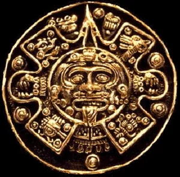
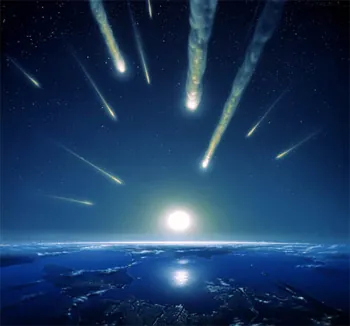
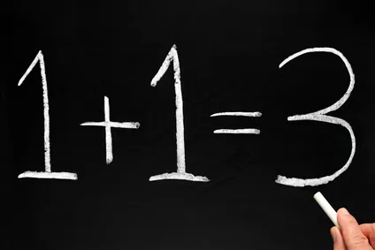
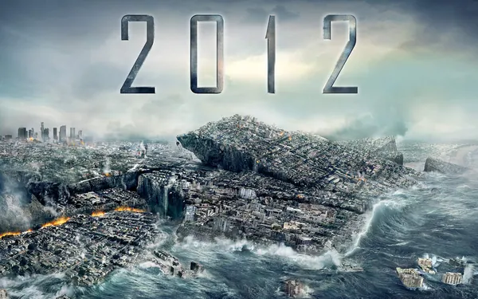

2012, quel beau nombre. 57 en base 3. 5+7 donnant encore un 12 en base dix. N'est-ce pas incroyable ? A mon avis c'est un signe de récursivité temporelle, et 2012 sera donc forcément la fin du monde.

Vous trouvez ça débile ? Et vos histoire de Mayas, vous appelez ça comment ? Que les choses soient bien claires, il y a d'un côté le film, qui exploite le buzz en insistant sur des faits soi-disant troublant, et il y a la réalité, le truc chiant où il n'y a jamais de fin du monde avec raz-de-marée global mais plus souvent une fin de journée avec raz-le-bol colossal. Et chaque fois que j'entend quelqu'un mélanger les deux, j'ai tendance à m'effondrer dans le second. Ce n'est pas parce qu'on vient de passer halloween qu'il faut faire des lanternes de vos vessies. A l'origine c'était juste des navets - avant d'être des citrouilles -, il n'y avait pas besoin d'opération lourde avec ablation d'organe.

Bon, je vois bien que vous avez du mal à percuter, alors lisons ensemble le synopsims, le synospice, le.... résumé du film ensemble et faisons la part des choses.

***Les Mayas, l'une des plus fascinantes civilisations que la Terre ait portées***

Jusque là rien d'anormal, on remarque une superbe conjugaison au subjonctif passé avec emploi du féminin pour le participe, et là je dis respect. Pas toujours facile à placer celui-là. Quant à la civilisation Maya, elle avait sans le moindre doute des connaissances fort remarquables en astronomie et en mathématiques - avec utilisation de la base 20 pour compter, et hop on raccorde avec l'intro -, mais faut pas déconner non plus, d'un autre côté ils n'avaient même pas encore découvert la roue. Oui oui, le truc qui tourne tout le temps et qu'est bien pratique quand on a pas envie de marcher. Alors qu'on vienne pas me raconter que ces barbares, dont la religion était principalement basée sur les sacrifices humains, et dont l'extinction s'est faite sans aide extérieure - comme pour les Aztèques avec la variole et le typhus ou pour les Amérindiens par invasion -, ne venez pas me dire, donc, que mes phrases sont trop longues. Ni que les Mayas étaient de grands prophètes et que leur message plane encore au dessus de nos têtes tel un nuage sombre, prêt à déverser ses foudres sur la pauvre civilisation occidentale pour la détruire et dans les ténèbres la dissoudre. Ca ne veut rien dire, mais c'est super classe. Notre civilisation est-elle soluble dans les ténèbres ? Cette question fera l'objet d'un débat a posteriori.

***Les Mayas nous ont transmis une prophétie : leur calendrier prend fin en 2012, et notre monde aussi.***

Attention, première chose avant que vous ne cédiez à la panique : les Mayas ne nous ont rien transmis du tout, pour la simple et bonne raison qu'ils se sont éteints tout seuls sans rencontrer le moindre pélerin. Alors bien sûr, ils auraient pu nous laisser un message. Encore fallait-il qu'ils s'attendent à ce que leur message soit lu - et donc qu'ils anticipent l'existence d'autres civilisations ailleurs dans le monde, qui n'est pas plat - et qu'ils souhaitent les prévenir d'un danger - quand ils pourraient très bien n'en avoir strictement rien à carrer, il faut bien l'avouer -. Ca, c'est le premier point.

Deuxième erreur, affirmer que le calendrier Maya s'arrête définitivement en 2012.

Pour commencer, le calendrier Maya, un système extrèmement complexe, prend fin en 2012, en 2180 ou en 2220, selon la méthode de calcul. En effet, la création du monde, selon les Mayas, date de 3114 avant JC. Leur calendrier "long" (il y en a plusieurs) s'étale sur 5127 années environ. La fin du décompte serait donc pour 2180. Déjà, ça nous fait un sacré rab de temps. Qui plus est, cette date n'est que la fin d'un cycle ! Après le 31 décembre, votre calendrier aussi se termine, n'est-ce pas ? Et un nouveau commence. Et voilà, vous avez tout compris. Anne ma soeur Anne, ne vois-tu rien venir ? - Non, et encore moins de fin du monde... Et d'abord, j'ai même pas de soeur Anne.

***Depuis, les astrologues l'ont confirmé***

Oui, alors là il s'agit des astrologues DU FILM, hein. Déjà parce que dans la vraie vie réelle, à part votre astrologue perso - Madame Irma Dilatélanus -, je ne crois pas avoir entendu un astrologue raconter ça pour autre chose que dans son propre intérêt pécunier, et ensuite parce, et vous avez fait l'erreur comme tout le monde, les gens qui étudient les étoiles, les planètes, et toutes les merdes qui tournent dans l'espace en un balai chatoyant, s'appelle des astroNOMES. Ce qui fait une belle diffférence, puisque ces derniers sont des scientifiques quand les premiers sont des charlatans. Ah ben oui, forcément, c'est moins glamour d'un coup, la fin du monde. Et donc je vous l'annonce solennellement, aucune planète tueuse n'a été repérée comme potentiellement dangereuse en 2012. Aucune menace. Rien. A peines quelques tonnes de météorites toutes pourries, comme tous les ans quoi. Exit la planète meurtrière. Exit aussi l'hypothèse du soleil qui quitterait sa course. Ce con là n'a pas bronché depuis sa création - en fait si, il est en permanente révolution autour du centre de la galaxie, et nous avec -, et d'un coup il arriverait à se faire la belle sans nous ? Quoi ? Plus de gravité non plus alors ? L'homme pourra voler en 2012 ? Waw, le scoop !

***les numérologues l'ont prédit***

Relisez ma démonstration d'introduction. Toujours pas convaincu ? Pourtant, c'est un peu ça, la numérologie. Retourner les nombres dans tous les sens jusqu'à ce qu'ils disent ce que vous voudriez qu'ils disent. Et encore, là, je me suis pas bien foulé, mais en faisant des additions à la con dans tous les sens, je suis sûr que je peux vous trouver l'âge du capitaine sans décoiffer le teckel du voisin. Tenez, au départ il s'agissait de 2003, pour la fin du monde "selon les Mayas". Ne me demandez pas pourquoi, mais il s'est passé que dalle. Du coup, on a qu'à dire que c'est 2012, parce que, merde, on est con, y'avait une poussière sur l'écran alors on avait lu 1+2, = 3, au lieu de 12. Qu'on est con quand même ! Titine, t'aurais pu faire la poussière merde, on calcule la fin du monde nous ici, on est pas là pour s'amuser...

***les géophysiciens trouvent cela dangereusement plausible***

Effectivement, la tectonique des plaques est dangereusement plausible, et risque d'emporter la Californie au large un de ces jours. C'est véridique. Maintenant ça peut être demain comme dans 2000 ans, personne ne peut le prévoir. Mais admettons, allez, que la Californie prenne le large en 2012. Et que le volcan de Yellowstone se réveille et nous engloutisse tous, le 21 décembre. Ca aura prouvé quoi ? Que dalle, puisque selon les croyances Mayas, le problème viendra de l'espace. Du coup, envisager de faire confirmer une "prophétie" - même pas une hypothèse - astronomique par des géophysiciens, ça devient carrément pathétique. C'est comme Régis, le pilier du bar de mon bled, quand il me fait la météo. Il est con ce Régis.

***et même les experts scientifiques gouvernementaux finissent par arriver à cette terrifiante conclusion.***

Quelle conclusion ? La fin du monde ? Les experts gouvernementaux, ceux qui préfèrent demander au nuage de Tchernobil de s'arrêter à la frontière pour pas effrayer le chalant, ceux qui pensent qu'il n'y a aucun risque à avoir des micro-ondes toute la journée dans la tronche alors qu'expérimentalement, ça tue les poussins dans l'oeuf, on parle bien des mêmes ? Ces types qui trouvent que rien n'est grave, parce qu'il faudrait pas que Mme Michu panique, et tant pis si ça fait des milliers de morts, ces gars-là en viennent à penser que la fin du monde est pour 2012, si les Mayas le disaient, c'est sans doute vrai... Allez, restons sérieux cinq minutes. Même si la moitié de la planète était ravagée le 21 décembre 2012, les experts scientifiques gouvernementaux seraient encore là pour nous dire que, par chance, c'est en passe de se calmer et qu'on a rien à craindre...

***La prophétie maya a été examinée, discutée, minutieusement analysée.***

Oui, principalement par deux types de personnes. Les paranoïaques illuminés qui ont raté leur vie et espèrent bien que d'abord tout le monde il meurt en 2012 et que d'abord ça sera bien fait, fallait pas se moquer d'eux en CM2, et les scénaristes de 2012, le film, pour l'écrire, ce film. Et encore, on se demande bien comment ils ont fait, puisqu'aucun d'entre eux ne sait lire le Maya. Du coup, si ils n'ont fait que s'inspirer des publications des illuminés genre Raël, on comprend mieux leur pessimisme et la rigueur désastreuse du gentil nanard grand spectacle.

***En 2012, nous saurons tous si elle est vraie, mais quelques-uns auront été prévenus depuis longtemps...***On s'était donné rendez-vous, la la la... Même pas peur.
