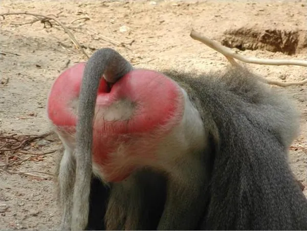
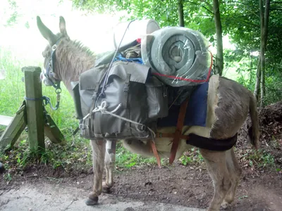
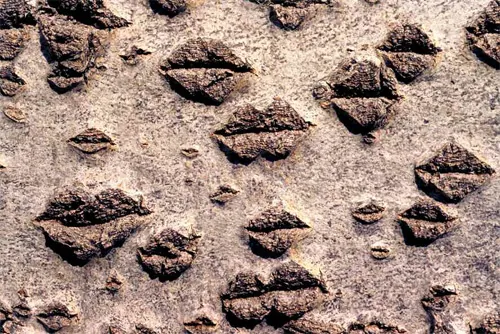
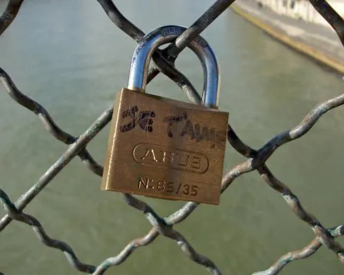

Récemment, la ville de Paris eut à déplorer la disparition de centaines de verrous clandestins. Aussi baptisés "les cadenas de l'amour" et fleurissant dans de nombreuses métropoles, petits bouts de métal barbouillés d'encre indélébile, ils étaient tous le témoin d'une union, ancrant les débiles, symbolisant avec brio l'absurde petite prison refermée sur elle-même qu'est l'esprit d'une victime de l'amour. Quel romantique maladroit a-t-il bien pu penser une seule minute que c'était une bonne idée ? Et pourquoi tous ses congénères se sont-ils mis à le suivre dans sa folie ?

Finalement, qu'est-ce que tomber amoureux, sinon la création d'une frustration passagère ? Frustration dont l'issue n'est jamais positive, puisqu'elle débouche soit sur une déception, soit sur une aliénation mentale profonde. En effet, en cas de consentement mutuel à échanger moult fluides corporels, le bonheur engendré par l'assouvissement d'un désir ajouté à la prise de plaisir - pour les plus talentueux du moins -, mène bien vite à la dépendance. Une seule personne devient la source de toute vie, quand des millions d'autres pourraient tout aussi bien procurer le même plaisir, si ce n'est bien plus, et se trouver bien plus à même de partager les goûts et les couleurs de la victime. De la même manière qu'on est toujours le con d'un autre, on est jamais la personne la plus adaptée à notre partenaire. Il est bon de le croire, mais la vérité reste présente en permanence, tourmentant l'amant et lui faisant éprouver le besoin d'obliger l'autre à s'abandonner, à prouver qu'il ne saurait être mieux qu'en notre présence. L'envie de s'approprier l'être aimé est une récurrence déplorable, et pourtant tellement irrépressible...

Alors, pour se prémunir de toute perte affective, l'amoureux confit s'imagine de nouvelles méthodes. Pour que l'amour soit complet, il faut que chacun souffre, et le couple se construit une prison morale assez restrictive pour s'assurer qu'elle est trop petite pour y entrer, afin de pouvoir pleurer après d'en être sorti. La jalousie naît d'un côté, les cadeaux abondent de l'autre, comme le bâton et la carotte pour conduire l'âne aimé dans le sens désiré. J'accepte tout de toi, même ton passé, mais s'il-te-plait, ne me parle plus jamais de ton ex. Je veux ton bonheur, que tu sois heureux, mais je t'interdis de t'amuser quand je ne suis pas avec toi. Enfin, je te comprends si bien que je te connais par coeur, mais comment as-tu pu me faire ça espèce de salaud ? Les grands projets eux-mêmes en viennent à empiéter sur le terrain affectif d'un amour entreprenant, faisant naître une rivalité superficielle entre un être humain - ou une chèvre, pour mon public rural - et une simple idée, abstraite. Alors on cherche un moyen de rendre cet amour sacré, intemporel, transcendant.

Par le passé, un de ces moyens était de graver les initiales sur un arbre. Malheureusement, dans une société consumériste comme la notre, pareil acte, totalement dénué d'aspect financier, n'a plus aucune valeur. Si vous voulez être un gagnant, il vous faut une belle montre. Si vous voulez montrer que vous êtes un mâle dominant, il vous faut une grosse voiture. Et si vous voulez montrer votre amour, il vous faut offrir un bijou. Meurtrir un arbre, quelle idée absurde ! Le romantisme moderne ne s'encombre pas de symbolique végétale. Le bois, la nature, c'est dépassé. Et si on rendait tout ceci plus consistant, plus puissant, en le corrompant dans l'argent, le laiton et l'industrie ? Rendons le procédé onéreux, sale, et mécanique. Célébrons l'amour en achetant un cadenas et enfermons nos sentiments sous une épaisseur de scotch dans la balustrade métallique d'un édifice de voirie. Enfin, assurons-nous que nul ne saurait mettre fin à ce symbole universel en jetant la clé du verrou dans le cours d'eau qui s'écoule en contrebas.

Ainsi, on rira de voir que certains cadenas étaient estampillés "ABUS", une marque au nom bien à propos. J'abuse de toi, j'abuse de mes libertés pour imposer à tout le monde la vision pitoyable de mon amour réduit à un assemblage métallique rouillant dans une rue de Paris. Mon absurdité aura au moins le mérite de faire le bonheur des récupérateurs de métaux à la besogne nocturne. L'histoire ne compte pas le nombre de couples brisés par un cadenas dérobé à son état végétatif. Parce que si le symbole de votre amour, l'objet même vous permettant de contraindre l'autre à rester auprès de vous, disparaît, comment pouvoir encore faire confiance ? Comment continuer à aimer, alors que ce que nous étions est en train de fondre dans une cuve bouillante de laiton en fusion ? J'ai maintenant peur que cette chaleur que j'aime en toi ne plaise à d'autres. D'autres mieux que moi. Finalement, j'ai peur, je me déteste. Je suis trop naïf pour avoir cru être digne de toi. La télévision a raison. Le matérialisme me conforte dans mon aveuglement possessif.

Je ne suis rien, c'est pour ça qu'il me faut tout.
