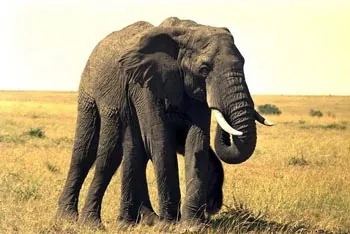
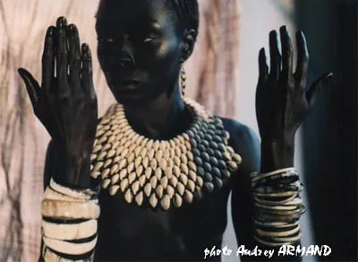
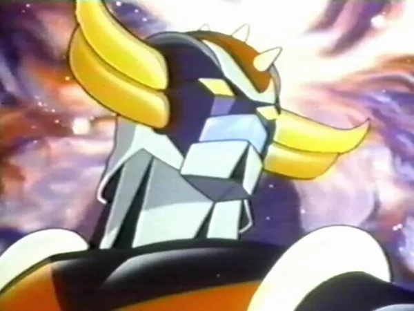

Les mecs, j'ai eu une putain d'idée de folie pour battre tous les records de l'histoire du cinéma. Je m'aime, vous savez pas comment. Attendez, je vous raconte. Alors tout commence dans le futur. Ou dans un présent parallèle, en fait on s'en fout, l'important c'est que l'humanité voyage dans toute la galaxie et exploite les ressources de planètes éloignées. Il faut 5 ans pour voyager sur plusieurs années lumières, ce qui implique qu'on peut donc voyager au delà de la vitesse de la lumière, mais qu'il faut quand même subir une cryogénie, pour éviter de vieillir le temps du trajet. Je sais, quitte à aller plus vite que la lumière, pourquoi pas accélérer encore un peu pour que le trajet fasse pas plusieurs années, et puis d'abord si tu vas plus vite que la lumière, est-ce que tu risques pas plutôt de rajeunir en remontant le temps, etc... Ben non, ça deviendrait trop compliqué sinon. Mais bon, heureusement, on se réveille d'une cryogénie comme d'un somme, au point même d'avoir un petit creux. Voyez, tout s'arrange. Et au bout de ce voyage, une planète riche, très riche. Là-bas, on trouve des cailloux pas plus gros que le poing mais tellement chers qu'un seul vous permettrait de vivre heureux sur plusieurs générations. L'histoire ne dit pas ce qu'il se passerait si chaque humain avait un de ces cailloux, ni même s'il y aura assez de cailloux pour rembourser le voyage, on s'en fout.

Et là, hop, problème, sur cette planète, il y a de la vie. Mais de la vie genre classe, que même Darwin ne saurait expliquer. Par exemple, la plupart des animaux ont six pattes. Hein ? Pourquoi ? Mais non pour rien, d'ailleurs leurs pattes du milieux ne servent jamais, forcément, même pas de pouce opposable. A part que ça fait sacrément classe. Mais j'ai mieux encore. Les animaux peuvent se connecter les uns aux autres grâce aux espèces de petites méduses qu'ils ont au bout de leurs cheveux. Pourquoi faire ? Eh bien, à l'état naturel, je ne sais pas trop, mais pour l'histoire tu va voir c'est super classe. Mais c'est pas tout. Dans une subtile repompe de l'ambiance Final Fantasy et des diverses théories de Gaïa, la planète elle-même serait une sorte d'organisme vivant, par le truchement des ses arbres, dont les racines communiquent et créant un espèce de vaste réseau neuronal. Est-ce que ça sent pas déjà la tuerie ? Et quand un animal passe sous un saule pleureur luminescent (ouais, j'avais un peu picolé hier soir), il peut connecter sa méduse avec les branches du saule et entendre des enfants se marrer. Ca sert à rien, mais c'est pour montrer la puissance du bordel, tu vois.

Bref, les humains débarquent et découvrent un énorme gisement de la pierre à millions, cette fameuse richesse composée d'un matériau n'étant même pas présent dans la classification périodique des éléments, pour vous dire si c'est trop puissant. Le problème, c'est que ce gisement se trouve juste en dessous d'un arbre gigantesque tenu pour quasi-divin par des bipèdes locaux. Oh, oui, j'oubliais, parce qu'il y a sur place des africains très grands et tout bleu, un peu comme des schtroumpfs géants, qui parlent d'ailleurs un mélange d'africain et d'espagnol mal digéré. Toute une civilisation, toute une planète, habitée par tout un tas de nouvelles formes de vies, mais dont tout le monde se tape, puisque l'humanité entière est au courant, le monde n'ayant d'yeux que pour les cailloux, qui brillent même pas, on est pas chez Lady Gaga quand même. Et alors là, les humains, qui sont bien supérieurs aux indigènes locaux, décident donc de les déménager pour pouvoir accéder à l'arbre géant sacré afin d'aller creuser dessous pour récupérer le cailloux qui tue tout. Pour ce faire, ils commencent donc par apprendre leur langue et, ceci fait, décident de créer des hybrides mi-homme mi-mollette sans âme (comme des roux en fait), et qui ne peuvent s'éveiller que lorsqu'un humain les contrôle à distance. Oui, à n'importe quelle distance, disons que c'est une liaison symbiotique longue distance, un truc comme ça. Comment ça pourquoi ils se compliquent autant la vie ? T'as pas un peu fini de m'interrompre merde ? Tu veux couler mon film ou quoi ? Enfoiré !

Bon, alors les humains envoient ces nouveaux hybrides tout neufs pour discuter avec le peuple de débiles mentaux, mais comme y'en a marre d'attendre, ils décident finalement de trucider tout le monde. Heureusement, y'aura un bon soldat humain qui va se révolter et aider un hybride rebelle à sauver le peuple. Ah oui, parce qu'il y a un hybride qui tombe amoureux d'une débile au milieu du film, tu vois, pour plaire à la ménagère, l'histoire d'amour, c'est toujours ça de garanti. Et ce Roméo se révolte contre les humains en domestiquant le phénix légendaire, mais qu'on va appeler autrement parce que bon, on est sur une autre planète. Le héros finit par détester les humains qui ne voient que les petits cailloux sous terre et pas les joyaux qui vivent à la surface, hop, poésie, philosophie, tu vois, tout y est ! Bref, à la fin c'est super juste, sens du timing à l'américaine tu vois, mais quand même les gentils ils gagnent le combat final grâce aux indigènes et à la planète intelligente qui envoie, on ne sait pas comment, les hordes d'animaux qui l'habitent contre les vilains envahisseurs. A la fin, le rebelle humain devient un vrai indigène attardé adorateur des arbres en faisant transférer son âme terrienne dans sa marionnette hybride par l'intermédiaire des racines des arbres, qui sont décidément bien plus que de simples axones puisqu'ils peuvent même faire des trucs dont personne ne se doutait, l'occasion ne se présentant pas souvent de transférer l'âme (et la cervelle) d'un extra-terrestre dans le corps d'un hybride indigène/E.T., le tout sans anesthésie.
Ils vécurent heureux et eurent plein de petits débiles arboriphiles.

Ouais, ok, ça va, c'est bon, je sais, ça marchera jamais.
