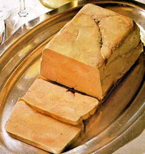
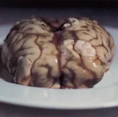
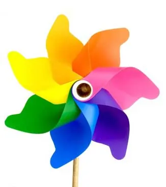

Alors que l'année 2010 aura surpris tout le monde par la ressemblance manifeste qu'elle possède avec l'année 2009 et ses chanteurs mourant, il est des choses dont on espérait bien qu'elles ne changeraient jamais. Et, comme pour nous en remercier, la nouvelle année ne faut pas à son devoir et apporte son lot de bonnes résolutions. L'opportunité pour les médiocres de s'améliorer ? Non, plutôt celle pour leurs amis de se marrer. Attention, frénésie meurtrière inside.

Comment mieux commencer une année que par un mensonge éhonté, une promesse qui ne sera pas tenue, et pire, une trahison imposée à soi-même ? Et toi, c'est quoi tes bonnes résolutions ? Comme tous les ans, me fixer des objectifs improbables et guetter la moindre occasion de passer à côté, mais large, très large. Tenez, pour 2010, j'arrête de fumer. Si si, mais bon, c'est impossible d'arrêter net, tout le monde le sait, alors je vais commencer par diminuer. Et pour pouvoir diminuer, la meilleure chose à faire, je pense que c'est d'abord d'augmenter. Voilà, c'est ça, comme l'idée d'arrêter de fumer me stresse, je vais me détendre avec un bon paquet et demi de clopes, et comme ça lorsque la pression sera retombée, je pourrais enfin diminuer ma consommation. Ha ha ! Ne suis-je pas ingénieux ? Toutefois, c'est toujours plus honnête que l'abruti qui va faire le tour de ses amis en se vantant de la décision irrémédiable qu'il a prise mais ira se planquer dans les chiottes pour se griller quinze galos pendant que les autres sont en pause devant l'entrée du bâtiment...
- Mais dis-moi Franck, mais tu pue le tabac ?!?!?
- NOOOON, sé pa vréééé ! Sééé pa mouaaaa !
- Allez Franck, retourne te coucher, sinon j'appelle l'infirmière.
- Nan, Franck il aime pas quand l'infirmière elle vient.
Et qui c'est qui va finir sous Prozac parce qu'il n'aura même pas été capable de changer ses habitudes d'un demi poil de cul ? C'est bibi ! Enfin oui, Franck.

Oui, parce que les bonnes résolutions, c'est AUSSI l'occasion rêvée de prouver à ses propres qu'on a pas une once de suite dans les idées, pas un seul petit sursaut de force de caractère. C'est afficher en 4 par 3 aux infos nationales du Bouquin à Facettes (Facebook in inglich plize) que non, on ne peut pas plus s'empêcher qu'avant de se ronger les ongles et que oui, on est une petite lavette avec une grande gueule. Moi, pour 2010, je vais changer le monde. Mais pour commencer, on va prendre l'apéro. J'ai essayé de changer, mais j'ai été retenu. Par qui ? Ah non, personne. Ce sont mes habitudes qui m'ont rappelées. Elles voulaient qu'on se revoit juste comme ça, en ami, et on a terminé sur la moquette à poil en train de se titiller le trou de balle. Mais c'est pas grave, des livraisons de bons sentiments, y'en a tous les ans. Et puis je l'ai toujours dit, 2010, ça sonne faux-cul, je pense que 2011 ça sera la bonne. Et oui, je pense, je n'ai aucune certitude, donc je suis, un gros con. Il faut savoir lire Descartes entre les lignes. Que celui qui a pensé faire appel à une voyante se dénonce et disparaisse dans la seconde. Descartes, bordel, le mec qui avait tout compris ! Né au seizième siècle, il avait déjà anticipé que la France serait vraiment un pays merdique et était parti mourir en Suède. Est-ce que c'est pas la classe ? On dit qu'il rêvait de rentrer en France, mais ce sont des conneries. Il avait juste mis ça dans ses résolution pour l'année 1650 histoire qu'on lui en veuille pas trop de nous avoir abandonné. Et paf, en février, décès surprise. Quel blagueur.

Mais les bonnes résolutions sont aussi une formidable manière de promouvoir sa propre superficialité. Il suffit d'ouvrir un magasine féminin pour s'en rendre compte, puisque ce sont ceux qui parlent le plus de cette tradition. Pour 2010, je maigris des cuisses. Ah, mince, c'est l'année de la saucisse. Tant pis alors, on verra la prochaine fois. Qu'est-ce qu'on a d'autres comme recommandations dans la presse des femmes pour les femmes ? Je soigne mes dents. D'aucun penserait qu'enfin, Karine de la compta va faire la connaissance d'une brosse à dent. Que nenni. Les préconisations sont les suivantes : détartrage et blanchiment. Hygiène dentaire, pour quoi faire ? Mais attendez, j'ai mieux, et ça raccorde avec l'article de la semaine dernière : "Pour 2010, je renouvelle ma garde-robe". Comme si les femmes n'avait pas déjà cette obsession en permanence à l'esprit, faut-il encore qu'on leur propose d'en faire leur priorité pour la nouvelle année. Pincez-moi, c'est un cauchemar ! Et ce n'est pas tout : "Une fois par semaine, je m'accorde quelques heures dans la salle de bains". Quelques HEURES ! Mais je n'oublie pas de sortir toutes les vingt minutes pour dire à monmarimondieu qu'il passe trop le temps devant l'ordinateur. Parce qu'il vaut mieux tartiner tout son corps de produits chimiques à l'origine douteuse pendant des heures que naviguer sur internet et peut-être enrichir cette saloperie qu'on a dans le dedans de la tête, ce truc qui sert à rien parce que de toutes façons on peut même pas le montrer au copine : la putain de cervelle.

Je m'énerve, mais c'est de bon coeur. Allez-y, servez-vous, y'a du rab. Si si, je voudrais pas vous laisser sur votre faim. Vous avez remarqué ? Ha ha, manquerait plus que je la joue stand-up. Vous avez remarqué ? Quand on est pas capable de faire une transition, on change de sujet en disant systématiquement "Vous avez remarqué ?". Mais je digresse. Ce qui m'amène à ma prochaine tirade sur le manque de logique et d'organisation. Comme quoi il faut pas grand chose pour créer une superbe transition quand on fait fonctionner la cervelle sus-nommée. Parce que bien sûr, les bonnes résolutions sont une opportunité formidable de dévoiler à la presse agglutinée autour de votre nombril vos cruels manques de logique et d'organisation. Un exemple tout simple. Pour 2010, c'est décidé, je deviens écolo. Non, qu'on se comprenne bien. Je veux dire, je continue de voter pour tout ce qui veut renvoyer les nègres en afrique, mais, par contre, je vais faire attention à bien trier mes déchets et à pas jeter n'importe quoi dans ma poubelle. Après tout, c'est dans la continuité de ma ligne politique. Je trie. Les nègres, en afrique, les plastiques, dans le bac jaune ! Bien entendu, ça ne m'empêchera pas de m'acheter trois machines à café par an et de changer de portable tous les deux mois, évidemment, je peux pas non plus me restreindre sur l'indispensable. Par contre, là où progrès s'il en est il y a, c'est que désormais, les vieilleries ringardes du genre téléphone même pas multi-touch screen ou les machine à café sans réservoir séparé pour l'eau lyophilisée, j'irai les porter à la déchetterie. Saluez l'effort, s'il vous plait, d'un nouvel écolo, qui va quand même se taper les 60 bornes aller retour à chaque fois qu'il aura un appareil désuet à jeter. Voilà. Merci.
