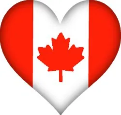
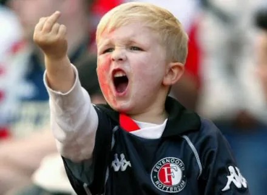
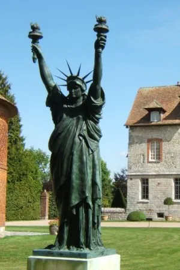
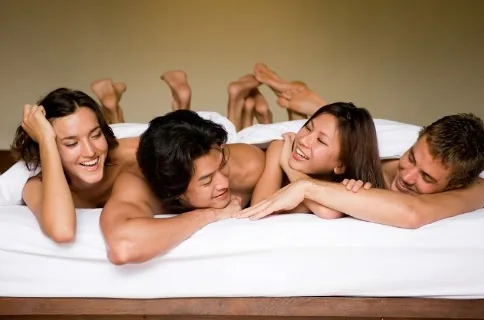

Il existe une planète, aux confits de l'univers, qui semble être une réplique exacte de la notre. Ou presque. En effet, là-bas, les gens sont super sympas. Ca ne les empêche pas pour autant d'organiser une coupe du monde de football, mais la différence c'est que tous les pays qui le demandent sont sélectionnés. Fort heureusement d'ailleurs, puisque tous les pays qui le demandent sont organisateurs, et ce sont souvent les mêmes. Enfin, quand je dis pays, j'exagère.

Oui, parce que sur cette planète, les gens ont la nationalité qu'ils choisissent. Il devrait donc y avoir un important brassage ethnique et un sentiment nationaliste négligeable. Seulement puisqu'aucun pays n'est défavorisé par rapport aux autres, qui ont la gentillesse de l'aider à combler son retard et partagent toutes leurs technologies avec le reste du monde, au final personne ne trouve d'intérêt à déménager dans un autre pays. Ceux-ci se valent donc tous, et vous pourriez demander à n'importe qui, il vous répondrait : "Ces gens-là sont vraiment bons, je me demande si je ne vais pas aller m'installer chez eux". En effet, comme personne n'a jamais aucune raison de quitter son pays, peu de gens en ont l'idée. Il suffit alors de la leur donner pour qu'ils commencent à sérieusement l'envisager. Mais ce n'est pas bien grave, déménager est très facile, quand tout le monde est là pour vous aider.

Pour les matches de foot, le jeu est bien plus compliqué que chez nous, mais aussi beaucoup plus spectaculaire. En effet, il suffit qu'un joueur souhaite marquer pour qu'on le laisse faire, ce qui permet de tenter des action assez incroyables. Mieux même, parfois on l'aidera à le faire. Chacun cherche donc à attraper la balle pour aller la mettre au fond de ses propres filets. Les gardiens de but peuvent prendre la balle à la main sur tout le terrain, mais ils ne le font pas trop, pour ne pas gêner le match. Toutefois, certains matches ne seraient rien sans les supporters. Lorsque personne ne se décide à mettre un but, ils sont là pour encourager leur équipe : "Allez les rouges, vous pouvez pas laisser les verts faire match nul, donnez-leur un point !". Et les supporters adverses de prendre respectueusement la parole à leur tour : "Mais vous plaisantez ? C'est vous qui méritez de gagner ! Nous on a rien à faire là, allez les verts, offrez-leur ce point !". Et bien entendu, l'équipe qui a marqué le plus de points est qualifiée pour la phase suivante, à moins que l'équipe adverse ne conteste, ce qu'elle ne fait pas, étant bien trop fair-play.

Ainsi, la valeur d'une équipe se mesure au nombre de matches qu'elle a perdu. Les moins doués se retrouvent fatalement à gagner la phase finale de toutes les compétitions. Mais être champion du monde n'en est pas pour autant une honte. Bien au contraire : puisque les meilleures équipes sont celles qui perdent le plus vite, l'équipe championne du monde est donc celle qui a le plus cédé la place aux autres pour remporter la défaite. Je sais ce que vous êtes en train de vous dire : "Une planète comme celle-ci, qu'est-ce que ça doit être chiant !". Vous croyez ? Vous n'avez donc rien compris. Sur cette planète, si vous voulez être footballeur, il vous suffit de demander. Vous ne jouerez probablement qu'un seul match, puisque vous accepterez ensuite de céder votre place à un autre demandeur. Mais rien ne vous empêche ensuite de demander à être président, ministre, ou n'importe quoi d'autre. Rien n'est impossible, rien n'est interdit, puisque personne n'a jamais envie de faire de mal.

Pour des questions de référencement, je voudrais ne serait-ce qu'évoquer avec vous la vie sexuelle des habitants de cette planète. Ah, vous voyez qu'on ne s'y ennuie pas ! Vous avez accès à tous vos fantasmes, sans limite. Et mieux encore : ça ne gêne personne, et tout le monde trouve ça normal. Bien entendu, les hormones existent, puisque ces gens sont quasi-humains. Ils ont juste une défaillance au niveau de la jalousie, ce qui leur ôte toute capacité d'esprit de compétition, d'envie de nuire. Je ne vous cacherais pas que le niveau de vie y est très élevé. Imaginez toutes les richesses du monde partagées entre tous les êtres vivants. La technologie est librement accessible à tout le monde, et pour les choses les plus rares, chacun y a accès à tour de rôle. L'argent a disparu, pratiquement. Disons qu'il subsiste par tradition, mais tout à la même valeur, un billet. Le plus difficile est, finalement, de trouver à qui demander ce qu'on souhaite.

Fait amusant, il existe dans notre monde un domaine totalement identique au leur. On appelle ça le logiciel libre. Voilà pourquoi j'ai placé [mon livre, la Fuite du Cerceau, en Creative Commons](dead:http://www.ilv-edition.com/librairie/la_fuite_du_cerceau_phase_i.html) !
