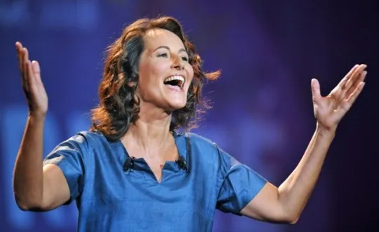

Après la vague d'antisémitisme qui gifla l'intelligence française à l'été 2008 et qui donna lieu à moult délations de la part de voisins inquiets ; après le tremblement de terre à Haïti, qui est trop loin pour qu'on s'en soucie, mais les photos de vacances des reporters sont quand même vachement classes ; après les affaires Mitterand et Polansky (alors qu'il m'avait toujours dit préférer la luge), la France est-elle en passe de subir le raz-de-marrée d'antipédophilie dans laquelle jouer avec un enfant est passible d'une peine d'emprisonnement et l'humour noir mérite une sentence capitale ?

Les discussions vont bon train à propos de la loi LOPPSI, destinée à lutter contre la pédophilie sans passer par le juge, parce que c'est quand même plus pratique, en gommant de l'internet les sites jugés comme tels par le gouvernement. Mais qui sont ces pédophiles assez crétins pour se revendiquer comme tel sur internet ? Ils sont malheureusement légion : écologistes, ultra-gauche, pirates en tous genre, tous sont réputés pour abriter en leur rangs les pires bassesses que l'humanité a engendrée. La destruction de caténaires n'est pas leur seul vice, et l'abus de petits enfants a été scientifiquement prouvé comme étant génétiquement relié à l'esprit contestataire qui fait le propre du bon gauchiste. Et parce qu'en parler, c'est déjà un peu le cautionner, l'abus de blagues pédophiles a été déclaré comme atteinte à la sécurité nationale par un panel représentatif d'internautes. Dès lors, c'est avec un entrain tout naturel que ceux-ci se sont rués sur le groupe Facebook du moment pour lui faire passer l'envie de nuire et d'être des gauchistes même pas décomplexés. Et pour le faire fermer, en alertant aussi bien le Ministre de l'Intérieur que la Garde des Seaux et le Préposé aux Bacs à Sable. Et, alors que le premier a déclaré vouloir éviter de sortir du débat pour rester en plein coeur du sujet, suscitant une vive polémique, le président est intervenu auprès de la presse afin qu'elle montre l'exemple à la population, et montre du doigt le groupe de vilains blagueur qu'il faut pas rire de ces choses comme ça. L'abus de blagues pédophiles encouragerait le terrorisme, c'est un fan de Desproges qui nous informe. Pierrot se retourne dans sa tombe, mais l'hérésie se poursuit. Pourtant, la censure n'est-elle pas le propre des dictatures ? La démocratie est donc le terrorisme. L'abus d'humour est alors démocratique. Mince, je me gauchise, pardon, j'arrête.

Et pourtant, on rigolait bien de Marc Dutroux, avec son nom improbable en pareilles circonstances. On envisageait même de distribuer des prospectus "Libérez Dutroux" à la sortie des écoles primaires. Parce que c'est drôle ! Mais on ne l'a pas fait. Parce que c'est moins drôle. Ce serait comme si, par exemple, le Président disait qu'il allait nommer un pédophile à la Culture, ça ce serait drôle. S'il le faisait... ouais, non, mauvais exemple, attendez. Tenez, ce qui serait drôle, voilà, ce serait par exemple que la justice s'en mêle. Prenez le titre du groupe "Il n'y a pas de pédophiles, il n'y a que des enfants faciles.". Ces mots sont-ils condamnables ? Il ne portent atteinte à personne, ne sont pas une incitation à quoi que ce soit de répréhensible, et ne sont finalement qu'un jugement totalement erroné en partant d'un principe parfaitement inversé. Mais légalement, les insultes publiques sont condamnées par la loi. Les menaces d'atteinte à l'intégrité physique aussi. Celles de mort n'en parlons même pas. La diffamation, même enseigne. Par contre, l'humour ne l'est toujours pas. Mais que fait la police ! Dès lors, assimiler les membres d'un groupe de blagueurs à l'humour noir à un groupuscule secret de pédophile ("Tout le contenu est public", dixit Facebook), les insulter et les menacer de multiples sévices entraînant la mort, c'est revendiquer son étroitesse d'esprit mais sa volonté d'élargir son rectum par un séjour prolongé au trou, et pas n'importe lequel, si vous voyez ce que je veux dire...

Et si tout ceci était simplement parti d'une vaste incompréhension ? Comme beaucoup de gens, je me suis retrouvé entraîné malgré moi dans le tourbillon magnétique de ce groupe sulfureux. Mais, à ma décharge, je dois vous avouer que j'avais mal compris l'intitulé. J'ai toujours cru que les pédophiles étaient les gens qui aimaient les pieds. Comme "Les Petits Pédestres" dans Kaamelott, voilà, pareil ! Du coup, j'ai eu du mal à me remettre de l'acharnement avec lequel je me suis fait traité d'animal. Parce que, vous comprenez, techniquement, c'est tout à fait vrai. Si je vous disais "Bandes d'humains !", est-ce que vous le prendriez mal ? Pire encore, je suis pratiquement certain que ceux-là même qui me traitaient d'animal en était aussi, eux-même, si si, des animaux. Mais d'autres semblent parfois nous envoyer des messages de l'au-delà. L'au-delà du rire, en quelques sortes. Un état de décomposition de l'humour dans lequel plus rien est drôle mais tout devient drôle à la fois, car l'absurdité y étend son règne. C'est ce néant absolu qui me saute aux yeux lorsque je vois une phrase qui, lorsque passée au traducteur puis au correcteur orthographique, donne à peu près ceci : "Je suis très tolérant, mais pas pour les gens qui adhèrent à ce groupe". Et pourtant, qui c'est qui adhère ridicule ? Je suis tolérant, oui, sans aucun doute, mais seulement envers ceux que je tolère, alors ça c'est sûr. Comme disait De La Bruyère :"L'on ne peut rire qu'avec des gens de coeur, d'intelligence ou, s'ils n'ont ni l'un ni l'autre, de bonne éducation. Ainsi, vous le voyez, l'on peut rire de tout, mais pas avec n'importe qui.". Le génie de cette phrase, c'est qu'elle exclut directement toute personne ayant quoi que ce soit à y redire. Dès lors, se défendre en disant que oui on peut rire de tout mais que là ça va trop loin, c'est illustrer parfaitement la phrase et s'exclure d'emblée des trois groupes proposés.

A force de raccourcis faciles, on peut tout démontrer. Par exemple, si vous n'aimez pas la série Angel, vous êtes misogyne. Non pas parce que vous ne pouvez supporter une série au public majoritairement féminin, mais non, ce serait trop facile, et pas assez tiré par les cheveux. Démonstration. Suite à la rediffusion d'une saison de la série, vous rejoignez le groupe "A bas Angel" pour montrer votre mécontentement. Vous répétez "A bas Angel à bas Angel !". Là, par une subtile manipulation rétro-acoustique, je transforme vos dire en "Angel à bas, Angel à bas !". Aucune différence me direz-vous ? Erreur ! Répétez-le pour voir. Misogyne ! Mais si, ne voyez-vous pas : "En djellaba, en djellaba !". Si vous réclamez la djellaba, vous êtes donc musulman, et d'aucun diront de vous que vous êtes arabe. Il est alors très facile, par l'adjonction d'une pincée de mauvaise foi et d'une bonne louche de préjugés, de dire que vous êtes un machiste. Et voilà, hop. Ce n'est pas drôle ? Je sais. Mais c'est pas de ma faute, c'est à peu près le niveau nécessaire pour amalgamer humour noir et pédophilie. Et moi même, je ne vole pas plus haut avec mes insinuations à propos du Ministre de la Culture. Après tout, il n'y a pas de touristes sexuels, il n'y a que des thaïs aguicheurs. Il n'y a pas non plus de zoophiles, il n'y a que des poneys faciles. Ca peut se décliner à l'infini, et ça ne choque personne. Sauf quand ça touche au tabou d'une société qui préfère cacher les problèmes par la loi plutôt que de les résoudre à la source. Est-ce que cacher à vos enfants que le feu existe les empêchera de se brûler ? N'est-il pas pire de fermer les yeux que de se permettre de faire de l'humour tout en restant vigilant ? Quel est selon vous le meilleur restaurant du monde ? Auschwitz ! T'as déjà vu un restaurant avec autant d'étoiles ? Mince, je viens de déclencher une guerre mondiale, je m'excuse, c'est sorti tout seul.

Mais le clou du spectacle, c'est cette vraie victime de pédophile venue soutenir le groupe, et qui s'est vu imposer des mots terribles tels que "Pour soutenir un groupe en étant toi-même victime, c'est que tu devais le vouloir.". La blague de départ est-elle à ce point violente qu'on se permette d'être aussi ignoble à propos d'une véritable victime ? Parce que si le groupe rigole d'une généralité absurde et décalée, on touche là à l'expérience dramatique d'un être humain, en chair et en os. Je me suis donc permis de poser à la victime quelques questions, afin d'avoir son opinion sur tout ça. Après tout, qui peut s'estimer mieux placer qu'elle ? Pour des raisons évidentes, l'anonymat de cette personne sera conservé.

Quel âge aviez-vous lors de cette douloureuse expérience ?
- C'est arrivé durant ma septième année.

En gardez-vous des séquelles ?
- Ha ha ha ! Mon subconscient me fait signe que oui mais je pense que je m'en suis bien sortie. Je suis en psychanalyse malgré tout, donc sur un plan clinique mon subconscient a raison et j'ai probablement encore quelques séquelles, je souffre de par le fait d'empathie chronique.

Que pensez-vous des blagues pédophiles ? Est-ce qu'elle vous touchent ? En bien ou en mal ?
- Elles ne me touchent pas, je sais faire la part des choses entre humour et réalité. Un homme qui en insultera un autre en le traitant de "sale pédé" me choquera plus qu'une blague pédophile. De même qu'un geste déplacé envers un enfant me mettra hors de moi tandis qu'une blague raciste ne me touchera pas outre mesure. Et vice-versa pour chaque exemple précité. Tout est une question d'intention des propos : s'ils sont à portée humoristique je suis tolérante à 100%, quand bien même cet humour ne me ferait pas rire. La liberté d'expression est un droit inaliénable.

Pourquoi soutenir le groupe "Il n'y a pas de pédophile, il n'y a que des enfants faciles" ?
- Je soutiens donc ce groupe pour cette raison : la liberté d'expression. Et ce d'autant plus que le but est l'humour et non de créer un terrier de pédophiles masqués.

A votre avis, est-ce que parler de la pédophilie librement dédramatise l'horreur vécue par les victimes, ou est-ce au contraire une forme de compassion solidaire ?
- Je ne pense pas que parler de la pédophilie librement dédramatise l'horreur de la situation. En effet, je pourrais probablement devenir dangereuse pour un pédophile si l'un d'entre eux venait a croiser ma route mais je sais faire la part des choses : en parler avec humour n'empêche pas d'être capable d'en parler avec sérieux ! Ce n'est pas parce que je voue une haine féroce envers les pédophiles que je suis incapable de rire d'une pensée corrosivement drôle.

Pensez-vous que la loi LOPPSI, destinée à fermer des sites internet pédophiles sans passer par une autorité judiciaire, sera efficace pour lutter contre la pédophilie ?
- Je ne connais pas suffisamment le sujet mais j'ose espérer que les membres de cette brigade ne se contenteront pas de fermer les sites ! Le mieux selon moi serait d'infiltrer et ainsi de traquer les pédophiles pour les retrouver chez eux.

Croyez-vous que cachez le problème de la pédophilie peut aider à lutter contre celui-ci ?
- Non, bien au contraire seulement il ne faut pas confondre informer et faire du sensationnel. Le problème de la pédophilie est un réel problème de fond et crier au loup a chaque petit groupe insignifiant est plus néfaste à la cause que l'inverse. Je m'explique : plus on va pointer du doigt et crier au scandale rapidement et plus les "badauds" (au vue des commentaires qu'il m'a été donné de lire je pense que la majorité des délateurs manquait sérieusement d’instruction) se détourneront aussi rapidement vers un autre problème. Ils sont malheureusement si facilement manipulables par le premier média venu que l’on pourrait demain fonder un grand mouvement de solidarité populaire sur n’importe quelle situation pour autant que l’on se serve d’une campagne de communication suffisamment puissante.

Et, enfin, avez-vous un message à adresser à toutes les personnes qui luttent contre les blagues pédophiles parce qu'ils pensent que c'est leur devoir ?
- Mon message serait : l’ouverture d’esprit n’est pas une fracture du crâne ; et si au lieu de vous acharner sur des gens qui n’ont pas le même humour que vous vous utilisiez toute cette formidable énergie pour combattre la véritable pédophilie ? Ensemble nous pouvons vaincre ce fléau mais encore faut-il pour commencer par nous tourner vers les véritables coupables de cet acte monstrueux : les pédophiles, et non les comiques (de plus ou moins bas étage, je peux vous l’accorder).
