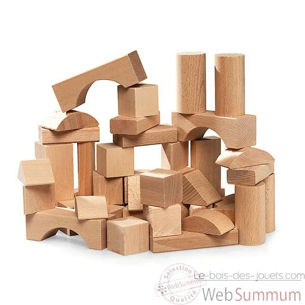
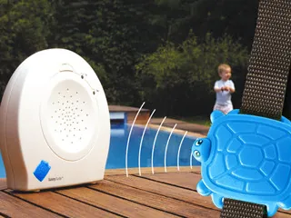
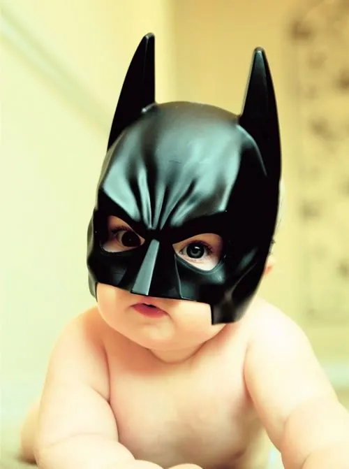
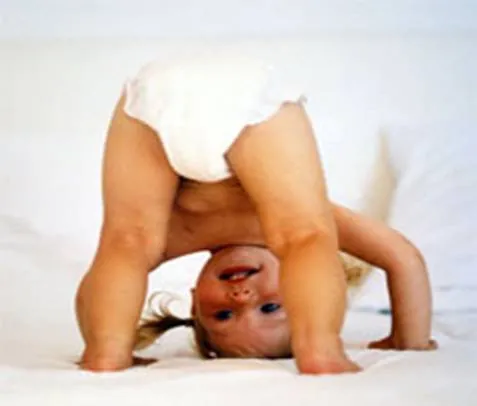

Après l'affaire des chiens affamés dévorant les jambes des handicapés, une nouvelle menace s'en vient planer au dessus de notre bonne humeur perpétuelle. Sommes-nous prêts à lutter ? Certainement pas. Pire encore, il semblerait que nous prenions plaisir à nourrir la menace afin de lui permettre d'étendre toujours plus ses ravages. Mais bien loin d'un effet de contagion, c'est d'un complot dont il s'agit manifestement. La conspiration enfantine. (Ca fait peur, je sais. Allez changer de culotte, et on se retrouve au prochain paragraphe.)

Oui mes amis, les enfants, c'est le mal. Et pour les filles, c'est la femelle. Ne vous laissez pas attendrir par la douceur de leur peau et observer leurs gestes. L'agressivité y transpire comme un bibendum aux caraïbes. Le masque bienheureux de leur bouille joufflue ne doit pas vous écarter de la cruelle réalité, de la sombre perfidie qui anime ces petits être parasitiques et dégoutants. Pas plus tard qu'il y a peu, l'un d'entre eux, précoce conspirateur à la frénésie meurtrière, fut découvert en bonne santé près du corps de sa mère sans vie. Nul ne pourra désormais crier à la coïncidence. L'enfant, bien loin des clichés gentillets qu'on lui attribue généralement, n'est pas dépendant de ses parents. Bien au contraire, c'est très tôt qu'il développe ses capacités prédatrices pour fondre tel un glaçon sur sa proie maternelle. Et c'est non pas de froid, rapport au glaçon, mais d'effroi, que la bonne maman part en déconfiture avant de finir, comme chacun sait, en tartine. Comment se prémunir contre pareil danger ? Ce sujet fera l'objet d'un prochain paragraphe. Mais d'abord, regardez votre enfant. Très bien, imaginez-le alors, là, devant vous, jouant nonchalamment avec quelques cubes d'apparence anodine. Que voyez-vous exactement ? Croyez-vous possible qu'il ne s'agisse que d'un bénin jeu de construction ? Ou comprenez-vous qu'il s'agit en réalité de la planification d'un acte aux conséquences bien plus dramatique qu'il n'y parait au premier abord ?

Malheureusement, il n'existe aucune solution exotique de précognition salvatrice et tous les vendeurs d'assurances ne sont que des charlatans, même si ça n'a pas tellement de rapport. Néanmoins, et certain m'auront devancé en ce sens, la surveillance donne parfois d'excellents résultats en matière de prévention. Mais pourquoi donc croyez-vous qu'il existe autant de "sécurité enfant" ? Serait-ce pour protéger l'enfant de lui-même comme on essaye de nous le faire croire, jouant sur nos sentiments pour mieux nous vendre un produit qui pourrait nous sauver la vie sans qu'on y prête attention, prouvant par là même qu'un commercial est un menteur, même s'il est persuadé de vouloir votre bien avant tout, même si ça n'a pas non plus de rapport ? En réalité, si les produits chimiques les plus dangereux sont dans des bouteilles impossibles à ouvrir sans avoir bac +5, c'est avant tout pour éviter que votre enfant ne confectionne une bombe en vue de commettre un attentat, aussi bien sur votre personne, que sur tout son entourage. De même, on ne s'étonnera pas de voir certains parents placer des interphones unidirectionnels dans la chambre de leur enfant. Ainsi, ils seront capable de se prémunir contre tout danger émanant de leur progéniture, s'évitant la surprise d'un croche-patte malencontreux en haut des escaliers par un bambin passant innocemment à quatre-pattes à ce moment précis. D'où également la présence de barrières de sécurité, auxquelles se raccrocher en cas de tentative inopinée d'atteinte à la bonne continuation de votre vie morne et dénué de sommeil.

Mais pourquoi sont-ils aussi méchants ? "Parce que" est bien entendu une réponse qui se glisse immédiatement dans mon esprit, à la faveur d'une rêvasserie publicitaire du plus mauvais genre. Mais pas seulement. N'auriez-vous pas les boules, vous aussi, si vous mesuriez moins d'un mètre, si vous aviez des bras trop courts, des mains minuscules, et que l'expression orale vous était encore parfaitement étrangère ? Ne voudriez-vous pas vous en prendre au monde entier si on vous obligeait à vous trimballer avec un réservoir à merde directement collé au cul et qu'on s'adressait à vous comme si vous étiez profondément demeuré ? N'auriez-vous pas des envies de meurtres, si toute la société était conçue pour des personnes de grande taille dotées de grandes mains, vous laissant parfaitement incapable de prendre votre autonomie et vous obligeant à supporter de longues heures enfermé dans une cage en bois avec pour seule compagnie trois peluches débiles et quelques hochets au bruit insupportable ? Sans parler des purées immondes et complètement fades alors que vous adorez manger épicé ! Pour toutes ces raisons, je ne leur jette pas la pierre. Moi non plus, je n'aimerait pas être un enfant en bas âge.

Petite précision. Comme vous l'aurez remarquez, cet article ne traite pas d'un aspect pourtant essentiel de la vie de tout animal : le rut. En effet, pour des raisons que chacun pourra comprendre, la simple évocation de la vie sexuelle pourtant manifeste de petits humains de moins de 15 ans vous classe automatiquement dans la catégorie pédophile, vous exposant à une décapitation médiatique des plus déshonorantes. Alors, et bien que la science peine encore à expliquer le changement métabolique qui peut s'opérer chez les humains dans la nuit qui précède le quinzième anniversaire, tout comme elle fut autrefois incapable de découvrir ce qu'il se passait réellement dans les pots de yaourt le jour de leur date de péremption, nous éviterons prudemment le sujet.
