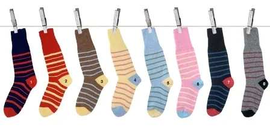
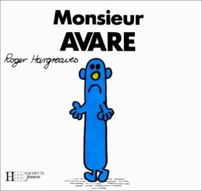

Alors que le thon rouge se raréfie et que le WWF et les Mayas prévoient son extinction pour 2012, une entreprise à vocation humanitaire aurait honteusement récupéré le nom de l'animal pour organiser une campagne de levée de dons. Heureusement, la concurrence veille et révèle le pot aux roses.

La vie est pleine de choix difficiles. Avaler ou cracher ? Demander au patron ce qu'il veut ensuite ou espérer que ça suffira pour obtenir la promotion tant espérée ? Se comporter en citoyen responsable ou faire un don humanitaire pour s'alléger la conscience ? Donner contre la faim ou pour le SIDA ? Non, contre le SIDA. Enfin pour sa recherche. Je crois. Mais d'où qu'il est le méchant virus ? Autant de questions qui s''imposent tôt ou tard à tout con patriote de bonne identité nationale. Et même s'il est toujours difficile de savoir si on cire les pompes comme il faut, il est facile de se dire que quoi qu'on puisse faire de plus ou moins respectable, le plus important est de se faire pardonner après. Ce syndrome, d'origine religieuse, ne bénéficie par ailleurs d'aucune recherche médicale, au point d'atteindre parfois des sommets chez certains hommes politiques, convaincus d'être tellement indispensables à l'Histoire qu'il ne saurait leur être reproché la moindre de leurs audaces.

C'est ainsi que depuis l'avènement de la politique et de cette merveille qu'on nomme "la démocratie", le peuple a toujours en grande partie cherché son intérêt personnel dans les programmes de chaque candidat. Et chacun d'entre eux, par corollaire, d'offrir à l'électeur un fascicule tout plein de rêves et de phrases sujettes à aiguiser l'imagination. Celui-ci propose une loi contre les nuisances sonores, c'est génial, on va enfin pouvoir faire taire le voisin. Ah oui, mais l'autre là, il veut renvoyer les sales arabes dans leurs pays, quitte à remonter l'arbre généalogique jusqu'à ses plus profondes racines, et c'est quand même pas négligeable. Bon allez, je me décide, je vais prendre celui-là, parce qu'il a quand même une bonne tête, et même si elle rase le sol, il peut pas être foncièrement mauvais, puisqu'il a la même Rolex que son copain Johnny. Tu te rends compte ? Johnny, mon idole, ma bataille. J'espère au moins qu'il aura le ministère de la musique. Ah, c'est pas le bouseux ni le facteur qui feraient ça !

Dès lors, tout le monde sera d'accord pour dire que face à de telles problématiques, les handicapés et autres malades bizarres, c'est vraiment pas la priorité. D'abord, les places qui leurs sont réservées sont toujours vides, alors c'est qu'il doit pas y en avoir tant que ça. Et puis je préfère avoir la garantie qu'on me prendra jamais plus que 50% de mes revenus, ça au moins, ça me concerne, et peu importe si je viens d'être licencié par un fond d'investissement américain et qu'après trente balais à faire le larbin j'ai peu d'espoir de toucher un parachute doré. Je vais me refaire, ça c'est sûr, et là, voilà, enfin, je pourrai dire au FISC, ha ha, vous aurez pas plus de la moitié de mon argent, non mais, faut pas déconner non plus. Dès lors, il est normal que les niches de la misère humaine aient été dévolues aux associations, permettant ainsi aux donateurs de s'élever au dessus de la masse des autres citoyens par l'altruisme de leur geste. Moi, au moins, je donne. Et voilà, le débat est clôt, le sage a parlé, il donne, il a donc raison.

Il ne viendrait à l'idée de personne, par exemple, que la recherche contre les affections qui touchent une petite partie de la population mondiale soit orchestrée par une organisation de portée équivalente et/ou que celle-ci soit financée par les états eux-mêmes. Parce que vous comprenez, si vous renversez quelqu'un en voiture et que vous partez sans attendre les secours, il vous reste toujours la possibilité de faire un don pour la recherche contre la tétraplégie, et voilà votre esprit serein. Vous avez fait une erreur, mais vous vous êtes rattrapé, et ça, c'est royal. Grand seigneur que vous êtes. Mais si c'était l'état qui prenait en charge ces recherches, à qui feriez-vous un don ? A la préfecture de police ? Avec un petit mot pour dire "*Ecoutez je suis désolé, j'ai mochement renversé quelqu'un le mois dernier, merci de faire parvenir cette somme au service de recherche pour les paralytiques*" ? Non, c'est bien trop risqué. Il vaut donc mieux laisser le boulot aux associations, elles, au moins, sont discrètes, tant qu'il s'agit d'encaisser des liquidités. Et avec un peu de chance vous recevrez même une petite carte de remerciement. Si ça c'est pas du pardon, qu'est-ce que c'est ?

Seulement voilà. Qui dit associations dit rivalité, concurrence. Et c'est ainsi que l'une d'entre elles, dédiée aux myopathies, ajouta dans son business plan l'organisation d'une grande manifestation télévisuelle permettant à tout un chacun de faire sa B.A. annuelle. Le logo choisi fut celui d'un hybride, croisement entre un humain et une tortue, sans doute pour mettre en valeur le côté amusant de la maladie. Mais si ! Quand on met un malade sur le dos il ne peut pas se relever tout seul. L'humour, ça marche toujours, et cette émission rapporta tellement qu'elle fit sombrer l'organisation dans ce qu'on appelle scientifiquement "la vicieuse spirale infernale de l'argent de la mort", ce qui la poussa à placer son argent, financer des entreprises, investir, boursicoter, et tout ce qui est vilain pas beau et qui fait qu'après, nous, les pauvres crétins de donateurs, et ben on a plus que le chômage dans la vie à cause de la crise financière qu'elle est internationale. Ne reste plus qu'une solution : se découvrir une maladie rare et espérer être pris en charge par l'AFM, l'association qui organise chaque année le Téléthon, avec la complicité des chaînes de télévision. Un conseil cependant, évitez la drépanocytose, pas assez rare pour être considérée, ou le SIDA, qui est une maladie de pauvre et ne mérite pas d'être soigné autant qu'une bonne myopathie des familles.

Aujourd'hui, l'émission n'est plus guerre qu'une maison de retraite pour artistes ringards, accompagnant poussivement des slogans n'ayant pas le moindre sens mais jouant sur la culpabilité des gens pour accumuler des sommes toujours plus faramineuses dans les comptes de l'association. Celle-ci dispose ainsi de plus d'un Téléthon d'avance sur ses comptes et a tiré de l'émission près d'un milliard et demi d'euros depuis sa création. Et quelle grande découverte lui doit-on ? Tout juste, l'invention des frais de collecte atteignant jusqu'à 20 % des sommes données. Une prouesse quand on sait que le taux atteint par les impôts pour leur collecte s'élève à environ 1 %, soit vingt fois moins. Et cela n'inclut même pas les actions de communication, qui comptent encore pour près de 2,5 %, ni les frais de gestion de l'entreprise, de plus de 7 %. Malheureusement, en dépit de tous ses efforts, l'association ne bat pas le record d'accaparement des revenus, toujours détenu par les majors du disque.
