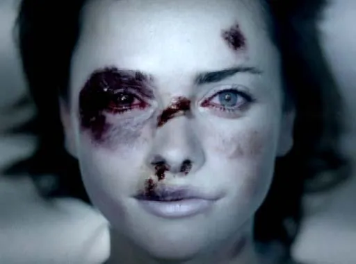
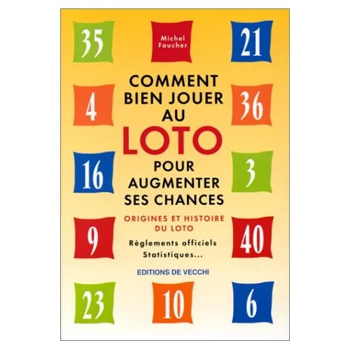

Automne 2009. Le peuple français est partagé. La grippe A mute et menace la survie de l'espèce humaine, et le gouvernement envisage de rendre son vaccin obligatoire pour écouler les millions de dose qu'il a commandé afin de relancer l'économie chinoise. Du coup, la sortie de crise lui semble acquise, mais il planifie malgré tout un grand emprunt. Cependant, dans la tête des français, toutes ces histoires sont bien peu de choses. Thierry Henry a mis la main, et, ça, vraiment, ça se fait pas.

Dans toute société normalement constituée, il y a des règles. Celles-ci peuvent être implicites, ou explicites. Les lois ne viennent bien souvent que graver dans le marbre un comportement déjà largement répandu. Néanmoins, rien ne vous empêche de passer outre. Prenons pour exemple le droit d'auteur. Il y a une dizaine d'année, tout le monde était d'accord pour dire que copier un CD pour le donner à un ami relevait de la contrefaçon, et chaque échange apportait son lot d'adrénaline, comme si la terre risquait à tout moment de s'ouvrir sous vos pieds pour le simple fait de n'avoir pas rémunéré les ayants-droit. Et puis, les mentalités ont évolué, le P2P s'est généralisé, et il est désormais tout naturel de permettre un accès à la culture le plus large possible pour tout le monde, indifféremment de ses moyens. Pourtant, le procédé est resté globalement le même, de sorte que la loi continue de l'interdire tout autant. Toutefois, il n'y a plus guère qu'un gros producteur pour s'en émouvoir.

Mais il en va de même dans tous les domaines. A part dans la finance, où il n'y a pas vraiment de règles, parce qu'on impose jamais de contraintes à celui qui tient le porte-monnaie. C'est ce qui a valu et vaut parfois encore à la femme son rôle de quasi-robot sexuel et ménager, parce qu'après tout si la grognasse rapporte pas de pognon, elle a qu'à fermer sa gueule, s'occuper des mômes et puis me faire un putain de dîner qui soit prêt quand je rentre du boulot, parce que moi, au moins, je bosse. Et là j'ai envie de dire conasse, mais ce serait trop vulgaire et je ne dois pas trop me laisser prendre au jeu de mes personnages. N'empêche que, vous l'admettrez, vous avez plutôt tendance à vous adresser à votre banquier sur un ton mielleux dégoulinant de bons sentiments que sur un ton autoritaire et méprisant. Pourtant, s'il y a bien un enfoiré de parasite qui mériterait qu'on lui fasse bouffer sa mère, c'est bien lui, votre banquier. A contrario, vous ne tenez pas la femme de ménage ni les éboueurs en grande estime. D'ailleurs, vous en parliez l'autre jour à votre gamin. *"Tu vois petit, si tu travaille pas bien à l'école, et bah tu vas finir comme le monsieur, à ramasser la merde des autres gens qui eux ont bien travaillé à l'école".* Là encore, c'est plutôt cocasse, mais de qui pourriez-vous vraiment vous passer, entre la banque et les éboueurs ?

Excepté la finance, donc, je ferme la parenthèse, tous les domaines possèdent leurs règles. Et part la même occasion, ils possèdent aussi leurs fraudeurs. Sont-ce de vilains personnages, prédisposés génétiquement à la triche et à l'escroquerie, et que même Jafar dans Aladdin il est pas si méchant ? Ou sont-ce juste des humains qui ont su se créer l'opportunité de contourner le système, parfois la peur au ventre, pour nous le mettre profondément dans l'oignon ? Et là j'en profite pour aborder dans un même temps le film *"The Box"* récemment sorti en salle et que, pour rejoindre mon deuxième paragraphe, vous allez tous massivement pirater. Si on vous proposait le million en échange de la vie d'un inconnu, et qu'en plus personne il saurait que c'est vous le crimier, est-ce que vous hésiteriez une seule seconde ? Deux ? Ce serait déjà faire preuve d'une grande mansuétude. Pourtant, la règle numéro un, civile comme religieuse, s'intitule *"Tu ne tueras point"*. Et même si dans le détail elle énonce que bon, on veut bien passer l'éponge si c'est pour tuer de l'ennemi ou du païen, le pognon ne fait pas partie des prérogatives vous octroyant le droit d'ôter la vie d'un individu, même inconnu. Et, non, espérer que l'inconnu soit un ennemi ou un païen, on appelle ça de la mauvaise foi, et ça compte pas.

En football, il y a des règles. Entre autres, il y a de pas mettre la main sauf si c'est pour faire une touche ou si vous êtes un gardien de but dans votre surface de réparation. Mais comme partout ailleurs, il y a la règle, il y a l'interprétation de la règle, et il y a l'application de la règle. Il arrive fatalement que le ballon touche une main par ci par là. Il arrive qu'un joueur s'aide un peu de la main pour faire progresser l'action. Mais comme dans toute situation, la condition sine qua none pour être sanctionné pour une faute qu'on a commis est que cette faute ait été vue ou prouvée par l'autorité de régulation. Celle-là même qui se nomme arbitre sur un terrain de football, et qui n'a rien vu lors du match barrage retour contre l'Irlande. Et voilà, on a gagné. Alors je sais bien que c'est pas très glorieux, mais quand on joue vraiment comme un pied, il ne reste plus qu'à mettre la main.

Thierry Henry doit-il quitter l'équipe de France, va-t-il le faire de lui-même ? Doit-on mettre Sébastien Chabal à sa place, histoire d'avoir une chance de voir l'embut adverse pendant la coupe du monde ? Ou doit-on au contraire féliciter celui qui nous a permis d'aller nous faire ridiculiser en Afrique du Sud ? 1994, la France n'est même pas qualifiée pour la Coupe du Monde. 1998, la France est championne du monde. 2002, on ne passe pas le premier tour. 2006, la France est vice-championne du monde. 2010... je vous laisse faire le calcul.
