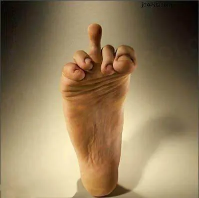
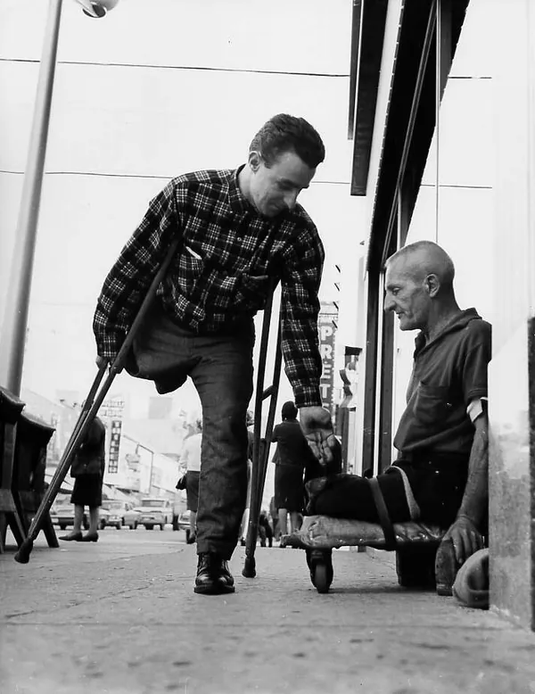
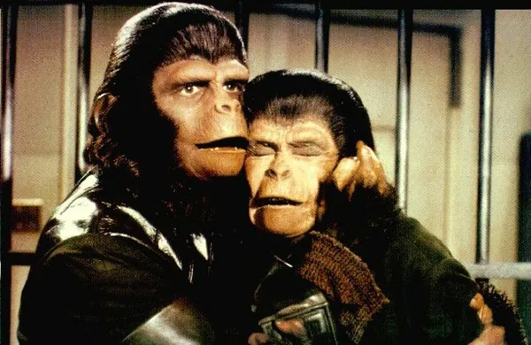
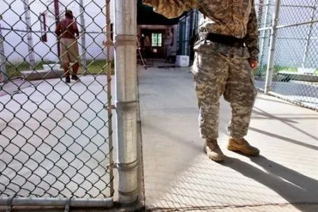
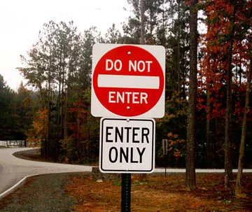
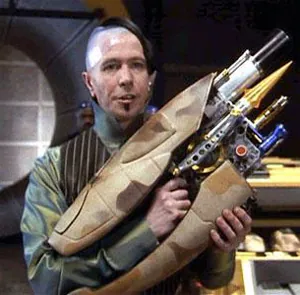

Tandis que le peuple français s'interroge à savoir s'il existe encore quelque part un parti politique indépendant de l'UMP pour lequel voter aux prochaines régionales, sans oublier de pleurer pour la convalescence d'une star n'étant déjà depuis longtemps rien de plus qu'une naine blanche, la cours du Roy organise la plus grande campagne de foutage de gueule jamais vue. Et tandis que les analystes s'accordent à rapprocher l'événement des dernières fêtes somptueuses de Louis XVI avant sa décapitation, la France se rend compte qu'elle a depuis longtemps démonté sa guillotine. Mais quel est le véritable message caché de ce lip dub ?

En choisissant une chanson niaise au message positif, les aspirants courtisans ont probablement voulu deux choses : se faire aimer du Roy, notre guide, notre étoile, notre Soleil, et montrer au monde qu'on peut très bien lécher des culs et chanter en même temps, avec un peu d'entraînement. En effet, si dans un élan d'honnêteté hors-normes la chanson sélectionnée avait été "C'est beau la bourgeoisie" de Discobitch, sans doute que ç'aurait été mal interprété, au plus haut de l'état comme dans ses couches les plus crasseuses. Pourtant, le message est sensiblement le même. Vous ça va ? Non ? Et ben nous on a vraiment la super patate, et on compte pas vous laisser nous gâcher notre plaisir. Déjà que depuis votre licenciement vous ne payez plus d'impôts et qu'on a dû réduire notre budget lupanar, on va pas non plus se laisser complètement abattre par vos lamentations. Et c'est ainsi que débute la plus sordide des campagnes publicitaires, véritable chant des sirènes, léger et séducteur, cachant maladroitement le rouleau-compresseur dictatorial dont l'emprise s'étend toujours plus, et ne s'arrêtera que lorsque les derniers sursauts de la véritable démocratie seront bel et bien enterrés, dans le même caveau que l'internet.

Le clip commence par un message adressé directement aux dizaines de millions de français qui refusent de se faire vacciner. ***"Le pire risque, c'est celui de ne pas en prendre"*** résonne comme un véritable pied de nez à tous les échaudés de la monarchie. Si vous n'aimez pas l'action du Roy, c'est que d'abord vous êtes rien que des lavettes. Insidieusement, le remède à notre poltronnerie s'affiche à l'image suivante : ***"Tu nous rejoins ?"***. A l'UMP, on est pas des pédés. Génétiquement, on est pas fait pour ça, on est costauds de père en fils nous. Une remarque qui ne serait pas sans rappeler la compétence de l'intégralité du gouvernement en matière de nouvelles technologies. Mais malgré la santé infaillible de la cours du Roy, celle-ci tente une manoeuvre d'humilité en nous montrant un partisan en fauteuil roulant. Après tout c'est pas de sa faute, c'est un enfoiré de communiste qui l'a renversé en voiture. Une victime de guerre, parce qu'on sait se battre, je vous le rappelle, on est pas des pédés, à l'UMP. Mais malheureusement, il n'y a pas de place pour les faibles en ce bas-monde, et l'handicapé sera oublié sur le quai de la gare dès le plan suivant, se trouvant dans l'incapacité de monter les marches pour entrer dans le wagon du TGV. Le légume évacué, le jeune couple qui l'accompagnait peut enfin se retrouver seul dans le compartiment afin de nous offrir une interprétation de dialogue banal digne des meilleurs films de boules de la décennie. Des films hétéros, bien entendu, parce que bon, on est pas des... ah vous le saviez ? Tant mieux.

Et nous voilà entraînés par la musique dans la plus profonde des perfidies réactionnaires, à commencer par son refrain.*"****Tout ceux qui veulent changer le monde****"*, qu'on se comprenne bien, n'a jamais voulu dire "en bien". Sinon, on aurait dit "améliorer le monde", par exemple. Non, changer le monde, ça peut vouloir dire un peu tout, et principalement le fait du Roy. On peut encore faire mieux dans l'injustice, et revenir au temps du servage. Si c'est pas changer le monde ça ! Et on ne va pas s'arrêter en si bon chemin. Notre petit Napoléon, de son bon appart', planifie déjà la conquête du monde. Il DOIT faire mieux que son ancêtre, et entrer dans l'histoire lui aussi. Alors si vous n'êtes pas une petite salope de communiste, auquel cas vos jours sont comptés, attendez-vous à prendre les armes prochainement. ***"Venez marcher venez chanter"***, ayez le suicide joyeux ! Après tout c'est bien vous qui avez voté, et démocratiquement à l'époque. Alors ça sert à rien de vous plaindre. A dire vrai, cette phrase aurait dû être (et paf, deux circonflexes à la suite) remplacée par "venez rejoindre l'UMP". Malheureusement, à l'UMP, on a du pognon, mais on a aucun talent. Du coup on a préféré pirater la chanson chantée par les canadiens, un peu comme on avait piraté MGMT pour un de nos meetings, ou comme quand notre pitbull Lefebvre s'amuse à mettre sur son blog des extraits d'émissions de télévision pour lesquelles il n'a aucun droit. De toutes façons, des droits, on en a pas besoin à l'UMP, on les a déjà tous. C'est si vous êtes un petit conard de communiste que vous avez pas le droit de reprendre une chanson ou une vidéo à votre compte ni même de la diffuser à votre entourage. Tant que vous êtes UMP, ça va, y'a pas de soucis, au pire vous serez amnistié. ***"Venez marcher à mes côtés"***, et étrangement, en même temps, Rama Yade s'affiche à l'écran. Faut dire que Nadine Morano nous dirait la même chose, on aurait plutôt tendance à se barrer vite fait dans le sens opposé. Ce qui ne l'empêchera pas de le faire, mais à la fin, faut pas déconner. Cependant, une question me brûle la vulve : si on prend la carte fidélité là, on peut toucher ?

***"Que toutes nos voix se confondent..."*** anticipe l'élection présidentielle de 2012. Oui oui, elle aura bien lieu. Après tout, on en organise aussi dans les dictatures. Par contre, ne vous attendez pas à un score inférieur à 80 % pour le nabot au premier tour. Nouveau Centre, Front National, Parti Socialiste, UMP, toutes nos voix se confondent de toutes façons. Les 20 % qui restent, ça nous permettra de savoir qui on va devoir éliminer. Les réfractaires. Et pour l'occasion on vous mettra la chanson de Silmarils... "Cours vite !". Mais le clip continue et, enfin, on nous offre le meilleur plan de toute la vidéo. Rachida Dati, Madame Dior, Miss Luxe, dans un halo de lumière éclatante, proclamant ***"J'entends la révolte qui gronde..."*** assorti d'un hochement de tête de négation significatif, de gauche à droite, et avec son petit air méprisant, voire provocateur : "vous n'avez pas le moindre pouvoir, on a déjà tout pris". Si ça c'est pas du foutage de gueule manière professionnelle, qu'est-ce que c'est ?

***"Pour que la Terre soit féconde"***, parce que je vous rappelle qu'en bons réactionnaires, les Jeunes de l'UMP sont catholiques, et suivent les caprices des Dieux que sont le Roy et le Pape, alias Amadou et Mariam pour leur manque de visibilité, Chirley et Dino pour leur aspect comique oscillant entre le forcé et le ridicule, et Black et Decker pour leur petit côté Bosch, du travail de pro, rapport à la Seconde Guerre Mondiale. Et en bon cathos, les courtisans n'ont pas le droit à la contraception, parce que c'est pécher. D'où, fatalement, fécondité outrancière. D'ailleurs, celle-ci est voulue, puisque ***"Il est nécessaire que l'on fonde une nouvelle société"***. Ben oui, tout le monde qu'on va massacrer, il va bien falloir le remplacer ! Et ***"Si les racines sont profondes, nous saurons bien les transplanter"***. Oui oui, il s'agit d'une menace. En gros, marche pour nous, ou crève. De toutes façons on va te sortir de tes petites lubies contestataires, donc soit la greffe prend, et on verra au résultat, soit elle ne prend pas, et tu va te retrouver tout seul. Très seul. Non, pas pour toujours. Jusqu'à la fosse commune disons.

Le deuxième moment fort de la vidéo se dessine alors, avec un Lefebvre presque souriant, osant le passage ***"Pour laisser fleurir à la ronde les chemins de la liberté"*** sans blêmir. L'homme qui veut contrôler internet. L'homme le plus hostile à la liberté quand ce n'est pas la sienne. Peut-être le symbole de l'intolérance et de la vilénie, parlant de liberté, tout en faisant ostentatoirement avec ses mains une petite cage, manière de dire que la liberté, c'est bien, tant que c'est celle qu'on vous a choisi et que vous n'en sortez pas. Une sorte de liberté captive. De la véritable novlangue tradition 1984 avec doublepensée dystopique. Une saloperie devenue légion. Un exercice d'aveuglement par auto-manipulation destiné à détruire la dissonance cognitive chez l'individu. La captivité *c'est* la liberté. Il n'en existe pas d'autre. Circulez. ***"Et tant mieux si la Terre est ronde, nous ne pourrons nous arrêter"***. Vous pouvez toujours fuir, au bout d'un moment vous aurez fait le tour, et on vous aura. Pire encore, ***"Il n'y aura pas de fin du monde, la vie est une éternité"*** semble aborder avec légèreté le thème de la torture qu'on vous réserve, sans parler de celle qu'on vous inflige déjà en ce moment même. On comprend alors bien mieux comment nous serons "transplantés". Et plus nos "racines sont profondes", plus ça fera mal. Alors souriez et laissez-vous aller. Et pendant qu'il en est encore temps, prenez votre carte à l'UMP...

Et le refrain se répète, encore et encore. C'est votre dernière chance d'adhérer. ***"Yallah !"***, nous dit un plateau de scrabble, ce qui veut dire "Allez !" en arabe. ***"Vivre d'amour et mourir d'espérance"***, c'est une fatalité. Prôner l'amour des valeurs républicaines, c'est s'assurer moult sévices qui vous accompagneront vers votre fin. Que croyiez-vous faire ? ***"A chaque jour l'avenir recommence"***, c'est irrémédiable. *"J'irai jusqu'au bout"*, nous avait-on annoncé... ***"Le temps est court le parcours est immense"***. Tu aurais tant à faire pour nous arrêter, et tu as si peu de temps avant qu'on t'attrape. Enfin, le supplice s'achève sur cette phrase, ***"Changeons le monde"***, ressassée depuis le début, agrémentée de la mention ***"Ensemble"***, sonnant autant comme une invitation que comme une mise en garde. Puis, avant de céder la place à un petit coeur rose en carton arborant le nom éternel de notre souverain et porté par une jeune femme à l'attirance manifeste, un dernier slogan s'affiche, pour conclure sur une note positive afin d'achever la manipulation de votre petit esprit fragile qui y verra alors la seule échappatoire ***"Devenez populaire, rejoignez le mouvement"***. Parce que l'UMP a malgré tout bien compris ce qui motive les gens à s'exposer autant sur internet : faire parler d'eux.
