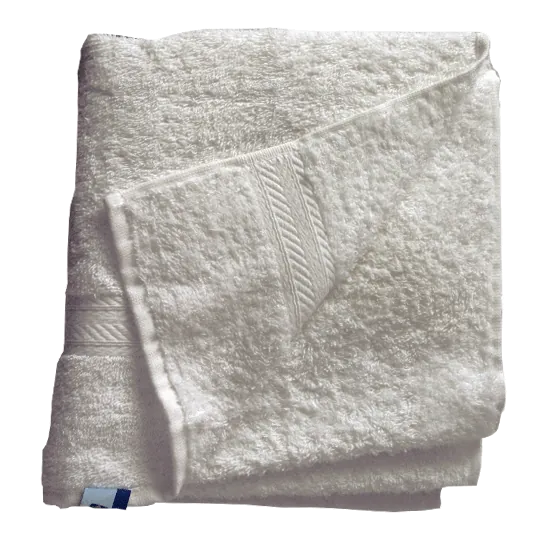
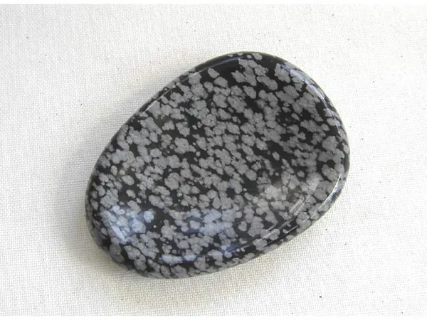
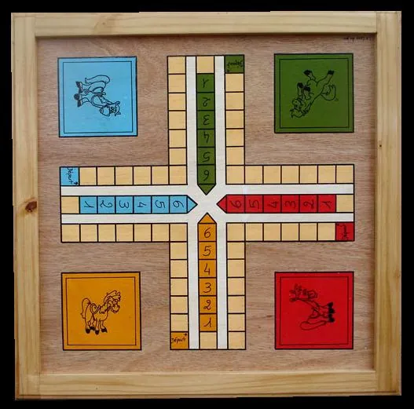
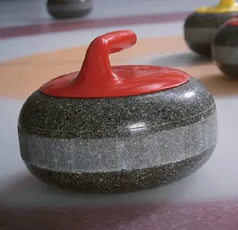

Depuis la révélation par une société spécialisée d'une nouvelle serviette hygiénique au format cadre photo capable de naviguer sur internet, le monde entier retient son souffle. J'arrête de respirer tant qu'on ne m'aura pas expliquer qu'est-ce que c'est que ce bordel, qu'il aurait même dit, le monde. Et, alors que tous les écologistes pariaient sur une fièvre inévitable entrainant la mort de toute vie sur terre par overdose de chaleur, c'est peut-être finalement à l'étouffée que nous cuirons tous d'ici peu.

Essayez de vous imaginer le choc que ça a pu être. Vous êtes une petite planète, tranquille, et vous observez le développement de vos parasites préférés. D'absurdité en absurdité, ceux-ci vous divertissent, mais parfois aussi vous étonnent. L'invention du vêtement, pour ne pas avoir froid, qui devient finalement obligatoire en toutes circonstances. La domestication des autres espèces de parasites, la culture des poils, que vous avez vert et dont ils se nourrissent. Puis, le forage de vos boutons afin d'en tirer un or noir pouvant servir de combustible. L'âge industriel, les inventions, le transport, la communication, tout s'emballe et vous perdez le contrôle. L'informatique et internet aidant, vos parasites ne se montrent plus. Non, ils restent chez eux, dans leurs maisons de squams. Ils y ont tout le confort nécessaire et ne sortent plus que pour s'engouffrer dans des cabines filant à toute vitesse. Jusqu'au jour où vous en avez marre. Leur nouvelle invention vient d'être annoncée, et vous n'osez y croire. Il s'agit visiblement d'un "pad", artifice d'hygiène féminine, au format démesuré, auquel on a trouvé utile d'adjoindre la navigation sur internet, le réseau de communication préféré de vos parasites. Mais pourquoi ?

Perplexe, vous cherchez à comprendre. L'objet n'est pas flexible, et son format semble bien inadapté pour aller se loger là où vous l'attendiez. Il ressemble plutôt à un cadre photo en fait. Mais quel rapport avec internet ? Et surtout, pourquoi l'avoir fait "multitouch" alors que les parasites ont toujours appris à leur progéniture à ne pas mettre les doigts sur les photos ! Non, ça doit être encore autre chose. Si on doit mettre les doigts dessus, c'est qu'il y a une raison. Un ordinateur ? Non, impossible, il n'y a pas de clavier, pas de ports USB, pas d'accès à la mémoire, tiens, vous vous y connaissez plutôt pas mal en informatique, finalement, pour une planète ! Ce n'est pas un ordinateur. Qu'est-ce qui peut bien aller sur internet à part un ordinateur ? Un téléphone ! Non, vous imaginez mal vos parasites téléphoner avec une feuille A4 collée sur l'oreille. Ils seraient ridicules, et ils ont horreur de ça. En plus, l'objet n'est visiblement pas prévu pour puisque sa connexion au réseau téléphonique est en option. La visioconférence est également inenvisageable, puisqu'il n'a pas de caméra.

Une console peut-être ? Elles aussi vont souvent sur internet ! Voyons voir... Non, il n'y a aucun moyen d'alimenter l'objet en jeux. Peut-être à travers le téléchargement, d'où la connectivité internet. Mais comment jouer à un jeu sans clavier, sans manette, sans souris ? Déjà que sur la seule console tactile existante, les parasites pestent contre le manque de visibilité à chaque fois qu'ils doivent appuyer sur l'écran avec un stylet pourtant très fin, alors le jeu avec le doigt sur un gros appareil instable semble impossible. Que reste-t-il donc ? Peut-être cet objet ne sert-il qu'à "consulter" internet, comme s'il s'agissait d'un "terminal" dédié au réseau ! Mais, alors, ne devrait-il pas être capable de lire le Flash, le seul format d'animation dont internet regorge ? Et puis, il aurait peut-être fallu lui prévoir un port "RJ45", ce format qui permet aux parasites de se connecter à internet avec un câble lorsqu'ils se méfient des ondes de leur modem et de leurs téléphones sans fil ou sont avides de rapidité.

Décidément, vous n'y comprenez rien. S'il s'agissait juste de lire des bouquins, vos parasites ont déjà inventé d'autres supports plus adaptés, sans rétro-éclairage pour économiser leurs yeux. Pour taper des textes, il faut un clavier. Et puis même, il faut pouvoir se référer à des sources d'informations lorsqu'on tape un texte. Mais l'objet n'est pas multi-tâche et ne sera pas capable de vous laisser écrire et consulter en même temps une source d'information. N'espérez donc même pas écouter de la musique avec, à moins de ne faire que ça, mais alors il vaut mieux le son d'une chaîne hifi, d'un home-cinéma, ou même d'un ordinateur avec de vraies enceintes ! C'est vraiment du grand n'importe quoi. Le seule avantage par rapport à une tablette d'argile ou un rouleau de papyrus, c'est de pouvoir effacer plus facilement...

Vous avez toujours réussi à comprendre plus ou moins vos hôtes, mais là, c'en est trop. Déjà pour le curling vous aviez eu du mal à vous en représenter l'intérêt. Pourquoi lancer cet espèce de gros machin sur de la glace ? Pourquoi pas une simple balle sur une piste ? Et pourquoi balayer devant, si c'est de la glace ? Vous avez déjà vu beaucoup de monde balayer un sol gelé ? N'importe quoi. Mais bon, au moins, il y avait un objectif : poser la grosse connerie au centre d'une cible. Bon, c'est stupide, mais vous y étiez habitué. Mais alors là, non. Encore, s'il s'était agit d'un produit dont tout le monde se fout, une espèce de truc inutile mais marrant, vous auriez passé l'éponge. Mais voir le monde entier se tourner vers cet objet improbable, ça vous en retourne le magma que même un chou il s'en défriserait la raie. Y'en a marre. Vous allez donc faire votre caprice, parce que ça faisait longtemps, et cesser de respirer tant qu'on ne vous aura pas bien expliqué de quoi il s'agit. Et si vous perdez la vie, vos parasites pourront dire adieu à la leur. Ca leur apprendra.
