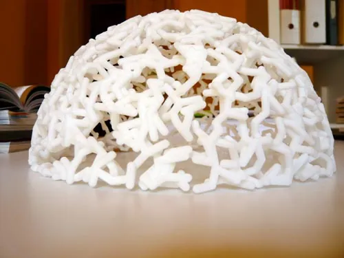
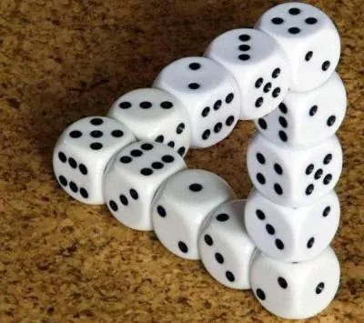
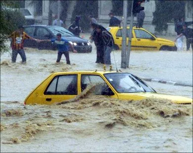

Alors que le public s'attend à une aventure épique à travers des mondes parallèles, un récit de science-fiction créatif mais plein d'histoires d'amour et d'amitié pour ne pas trop le déstabiliser, moi je vous propose en fait de parler de cinéma. Et je me pose la question suivante : jusqu'où ira son industrie pour nous faire revenir dans les salles obscurs afin de nous faire profiter d'une enrichissante expérience à base de moumoutes masquant une partie de l'image, de coups de pied dans le dossier du siège, de mouettes rieuses, de gros lards bouffeur de chips, de... bref, d'enfer sur Terre !

L'arrivée et le succès d'Avatar vient de propulser la 3D au rang de nouvelle technologie salvatrice pour l'industrie cinématographique. Pourtant, le concept de dimension est tellement perverti qu'on en vient à se demander si cet ajout est vraiment un plus. Pour autant que je sache, là où une image vous offre une expérience en deux dimensions, un film se projette déjà sur une troisième dimension, le temps. Dès lors, faudrait-il parler pour Avatar d'une quatrième dimension ? Réfléchissons. La profondeur est-elle une dimension ? Oui, sans aucun doute, X, Y et Z sont des axes, au nombre de trois. La profondeur est donc bien une dimension. Difficile à représenter sur un écran, mais belle et bien réelle. Regardons du côté de l'impression. Une imprimante classique restitue sur une feuille de papier une image en deux dimensions. Pour passer à la troisième dimension, les constructeurs d'imprimante ont imaginé la possibilité de superposer plusieurs feuilles de plastique découpées selon le modèle à reproduire, afin d'obtenir à la sortie un objet en trois dimension, sculpté par la machine. Un objet qu'on peut poser sur son bureau et qui n'a souvent que peu d'intéret, MAIS un objet dont les trois dimensions ne sont pas contestables.

Revenons-en alors au cinéma. Mettons nos lunettes. Waw, on dirait vraiment qu'il y a de la profondeur, c'est super. Comme dans mes magasines quand j'étais gamin avec des dinosaures qu'on pouvait regarder en 3D. Comme quoi ce n'est vraiment pas nouveau. D'ailleurs, le premier problème, c'est que sans lunettes, l'image n'a aucun sens. Lorsque je tiens un objet dans la main, il est en 3D, je n'ai pas besoin de lunettes spéciales pour ça - ou en tous cas pas encore, la réalité augmentée permettant d'envisager des objets virtuels mais néanmoins manipulables. Le second problème, c'est que si je me décale à 90° pour regarder l'image par le côté, je ne vois plus rien. Pourquoi donc ? Parce qu'il n'y a rien du tout en 3D. En fait, ce n'est qu'une illusion d'optique, comme le mouvement des personnages ne sont qu'une succession d'images que la persistance rétinienne se permet d'animer pour moi. La 3D est dans notre tête, dans notre cerveau, qui recompose les images reçues par chaque oeil en une scène dotée de profondeur. MAIS cette troisième dimension n'est pas palpable, et encore moins réelle.

Il y a quelques semaines, je suis allé voir un film en 4D. Véridique. J'ai chaussé des lunettes polarisées tellement mal conçues que je n'ai pu voir qu'un ensemble farfelu de formes plus ou moins évocatrices. Ce qui retire déjà les trois premières dimensions au film. Par chance, j'ai pu pleinement profiter de la quatrième dimension. Non, il n'y a rien de temporel. Non, ce n'est pas un odorama réchauffé, et heureusement, s'agissant d'un film sur la mer et la pollution. En fait, aléatoirement durant les séquences montrant de l'eau - soit 90 % du documentaire -, je me suis pris des gouttes d'eau dans la tronche. Le pied intégral... Ce n'était pas assez pour être mouillé, heureusement. Mais à quoi ça rime ? Sérieusement, qu'allez-vous donc nous inventer pour nous donner envie d'aller au cinéma, tout en produisant au final l'effet inverse - excepté les premiers temps grâce à l'effet de surprise ? Faudra-t-il bientôt se prendre une balle à la place du héros pour renforcer le réalisme de l'expérience ? Et, pire, payer un supplément pour ça ? Remarquez, ça donnerait tout son sens à l'expression "ça m'a coûté un bras"...

Alors moi j'aurais quelques suggestions pour nos amis du shaobiz. Dites-moi si c'est une connerie hein, mais est-ce qu'il ne serait pas possible d'ajouter une dimension scénaristique dans vos spectacles navrants ? Par exemple, bon, voir une voiture exploser dès qu'elle se cogne contre le moindre obstacle, avoir l'impression d'être à l'intérieur de la boule de feu et ressortir de la salle avec les cheveux cramés, c'est super, je dis pas le contraire. C'est pas mon truc, c'est tout. Mais serait-il possible de lever un peu le pied sur les kaboums et autres invraisemblances qui s'accumulent de plus en plus dans vos navets pour bosser cinq minutes le scénario. Parce que depuis quelques temps, quand je regarde un de vos films, j'ai l'impression de voir un film de cul, sauf que les scènes de sexe sont toutes remplacées par des scènes d'explosions ou par l'usage de multiples armes à feu. Quand ce n'est pas carrément un bâtiment qui s'écroule parce qu'un mec s'est cogné la tête contre le chambranle de la porte. Tout compte fait, non seulement j'ai l'impression de me faire baiser, mais en plus je n'ai même pas le privilège de le voir à l'écran...

La dimension n'aurait-elle pas simplement été prise pour un synonyme de déception. Le cinéma en trois déceptions, ça me semble tellement plus réaliste...
