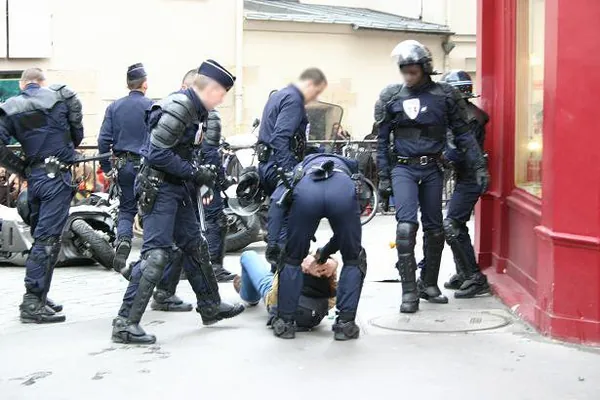
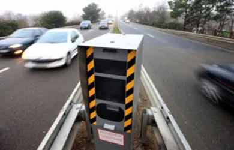

La nouvelle passion de la jeunesse après l'alcool plonge les forces de l'ordre dans une perplexité constamment renouvelée. Jusqu'où iront nos jeunes pour mettre au point les suicides les plus mystérieux jamais vus ? La tendance actuelle est inquiétante. Pendant des années, le jeune semble parfaitement normal, voire même épanoui. En réalité, il planifie déjà sa mort en tâchant de la rendre la plus spectaculaire et médiatique possible. Qu'avons-nous fait ? La société de l'information implique-t-elle nécessairement ce genre de dérives ?

La loi LOPPSI, destinée à protéger les jeunes contre leur gré, n'était même pas encore un germe d'idée dans le cerveau torturé qui lui a donné naissance, que déjà, des milliers de jeunes entamaient un rituel à long terme qui allait les mener irrémédiablement vers la mort. Le monde ne s'en rend compte que maintenant, petit à petit, à mesure qu'il assiste impuissant à la perte de son cheptel de nouvelle génération. Le dernier en date est un modèle du genre. Sélectionné par son pays pour le représenter aux Jeux Olympiques, un lugeur choisit de se suicider avant même la cérémonie d'ouverture, en signe de protestation contre l'absurdité de cette manifestation. A seulement 21 ans, le jeune avait semblé planifier son acte depuis de nombreuses années, et ses parents se rappellent aujourd'hui avec quelle insistance leur fils avait réclamé de faire de la luge à haut niveau dans un pays du Caucase dont c'est pourtant loin d'être le sport national. Et c'est donc par un voile noir que la cérémonie d'ouverture de ces JO nous reviendra désormais en mémoire.

Pourtant, on est en droit de se demander pourquoi un jeune souhaitant en finir avec sa vie choisirait une méthode aussi longue et coûteuse. La réponse semble être bien plus insidieuse qu'un banal effet de mode. Tout d'abord, parce que la mode est éphémère, et ne permettrait pas d'investir autant de temps dans son propre décès avant qu'elle ne tourne. De plus, un suicide traduit un mal-être auquel il faut mettre un terme rapidement, ce qui exclut d'emblée tout facteur temporel. Ensuite, la mode étant un vecteur de reconnaissance sociale, il est peu probable qu'une personne se suicide pour la suivre, puisqu'alors elle ne pourrait plus être reconnue comme appartenant au cercle social qu'elle revendique. Enfin, parce que la mode, bon, voilà quoi, ça mérite pas spécialement d'y consacrer sa vie au point de l'abandonner pour elle. Mais alors pourquoi ? C'est en menant une enquête exclusive pour Le Grand BaZART auprès des jeunes que la réponse nous est apparue : les statistiques.

En effet, à une époque où la vie ne vaut plus le coup d'être vécue, il est important de se demander ce qui nous retient en ce bas monde. La beauté de la nature poluée ? Non. Le possible chagrin de nos proches en cas de décès ? Pas du tout, car alors il serait similaire en cas de mort non auto-infligée. La véritable cause est politico-religieuse. Depuis que les gouvernements du monde ont compris qu'un croyant qui gobe tout et n'importe quoi est plus facilement manipulable qu'un athée qui se pose des questions, l'église est entrée à bras ouvert dans la ligne de conduite de ceux-ci. Tout ce qui vient de la religion et qui pourrait arranger les dirigeants d'une nation donne lieu à une nouvelle loi qui se répand ensuite rapidement autour du globe. C'est de cette manière qu'en France une loi anti-suicide, la LASSITUDE, pour Loi Anti-Suicide des Satanés Immatures visant à Tuer Universellement le Désir de ne plus Exister, est apparue récemment, interdisant d'attenter soi-même à ses jours, sous peine de voir sa famille condamnée à mort pour n'avoir pas été capable de procurer assez de bonheur à un de ses membres.

La jeunesse étant toujours la plus douée pour tout ce qui concerne le contournement de la loi, elle s'est donc attelée à trouver une solution pour continuer à se suicider en paix, malgré l'interdiction formelle. Et c'est depuis lors que sont apparus ce que la presse appelle déjà les "suicides à retardement". C'est donc de cette manière, après la LOPPSI, la HADOPI, la DADVSI, et toutes les autres lois destinées à empêcher les jeunes de vivre, puis la LASSITUDE pour les y obliger malgré tout, que les jeunes ont trouvé une fois de plus la parade afin de poursuivre leurs activités illégales. Le gouvernement prévoirait déjà une nouvelle loi, la LGROPD, pour Loi de Gestion, de Reconnaissance, d'Observation et de Pénalisation de tous les Décès, afin de lutter contre ce phénomène, en multipliant les malus d'impôts aux familles dont un des membres disparait, tragiquement ou pas. Ainsi, vivre deviendra une nécessité, et le gouvernement estime déjà que l'effet sur ses statistiques sera très bénéfique, entrainant une diminution des décès de 80 %, et qu'il pourra ainsi être réélu lorsqu'il présentera son bilan. De leur côté, les associations de citoyens gauchistes estime que cette nouvelle loi liberticide risque de provoquer des suicides en série entrinant la disparition de l'humanité d'ici douze années.
