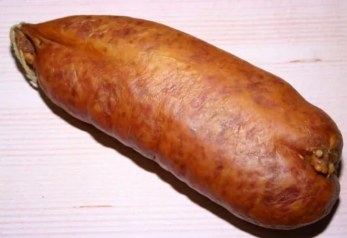
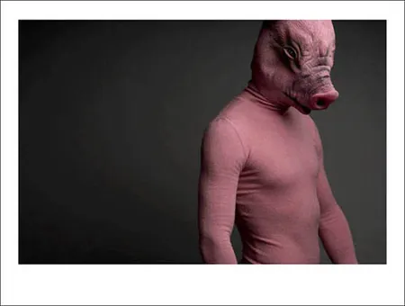
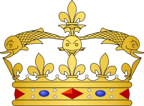
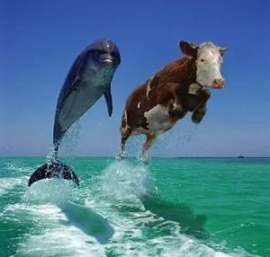

Avez-vous déjà entendu parler de dauphins dans les médias ? Et ça ne vous a pas paru étrange ? Pourtant, ce n'est pas un hasard, ni même un tabou. Les dauphins possèdent les médias, possèdent le marché, le monde, asservissent l'humanité qui, trop prétentieuse pour le reconnaître, préfère ignorer le problème. Non, vraiment, les dauphins, ça fait flipper !

Basiquement un dauphin, c'est quoi ? Rien de plus qu'une espèce de grosse saucisse de mer à l'intelligence surdimensionnée. Mais mettez-vous à leur place. Vous n'auriez pas les boules, vous, de vivre dans la mer et de même pas pouvoir respirer sous l'eau ? A mon avis, c'est bien là la base de toute la méchanceté dauphinée. Le grand conseil des dauphins a alors décidé de coloniser la terre ferme, au prix de quelques modifications génétiques. Le porc était né. Et du porc, il y en a partout, c'est bien la preuve. Et pas que dans nos assiettes ! Le banquier est un gros porc, le ministre est un gros porc, il y en a tellement... J'ai compris que mon voisin était un gros porc le jour où je l'ai entendu rire pour la première fois. Kekekekeeeek ! Non mais "Kekekekeeeek" quoi ! Ca ne vous rappelle rien ? Voilà, le dauphin ! Mon voisin était un dauphin terrestre, un porc maritime, un enfoiré d'envahisseur ! Oui, était seulement, parce que quand j'ai révélé la vérité à sa femme, elle en a fait de la chair à pâtée. Il manquait de sel son pâté d'ailleurs, mais je lui pardonne, c'était son premier mari, elle débutait. Depuis, elle et moi résistons contre l'oppression dauphine. Mais j'ai bien peur que la lutte soit vaine.

On reconnaît souvent aux dauphins une certaine intelligence. Moi, j'suis d'avis que pour commencer, un animal intelligent il aurait pas besoin d'étaler ses complexes en devenant un envahisseur. Mais étant donné ce que font les autres humains comme moi, même si ça me chagrine de le reconnaître, il y a pas trop de quoi flamber. Mais une chose est sûre : le dauphin a besoin d'eau. Pourquoi les cochons - mais oui, rappelez-vous, c'est le même animal à peu de choses près - pourquoi les cochons se roulent toujours dans la boue ? Par plaisir ? Est-ce que vous vous roulez souvent dans la boue par plaisir ? Non, évidemment, mais c'est parce que vous, vous pouvez nager ! Le cochon, lui, ne le peut pas, malgré sa parenté directe avec un cétacé. Son seul moyen de revenir à ses origines, c'est donc les bains de boue, dans lesquels il ne risque pas de se noyer. De toutes façons, l'analogie entre les deux animaux ne s'arrête pas à une simple ressemblance physique - groin, museau ou rostre, même combat. En grec, delphax signifie, je vous le donne en mille : cochon !

Quel était le premier dauphin de l'histoire à se mêler aux hommes selon vous ? Eh bien il s'agit de Guigues IV d'Albon. A l'époque les dauphins avaient encore pas mal de progrès à faire en nomination pour passer inaperçu. D'ailleurs, ce premier essai avait pour nom complet "Guigo Delphinus". Delphinus, c'est idiot comme nom de famille, on comprend tout de suite que c'est un dauphin. Suivit toute la lignée des Dauphins de France. Là encore pour la discrétion, on repassera, et je vous parle même pas de leur couronne et de leurs armoiries, conçues à la gloire de leurs ancêtres maritimes. De nos jours, les dauphins ont fait de nombreux progrès, et on ne les repère que très difficilement. Mais ils ont un point commun : ils détestent les arabes. Pourquoi ? Parce que les musulmans sont les seuls à savoir les reconnaître et à connaître la vérité. A votre avis, pourquoi est-ce qu'ils ne mangent pas de porc ? Tout devient clair hein ? Tenez, vous savez quel grand personnage est un dauphin actuellement ? Le président des USA. Rien que ça. C'est même le premier dauphin noir. Avouez que je vous surprends quand même. Les guerres successives dans les pays du moyen orient n'ont bien entendu pas pour cause le pétrole, mais plutôt les dauphins !

Dorénavant, j'espère que vous ferez plus attention en mangeant votre tranche de jambon. Derrière chaque jambon il y a environ un dauphin qui soufre. Et derrière chaque japonais un autre qui meurt. Si vous allez un jour au Japon, regardez derrière chaque japonais, vous verrez que je raconte pas de connerie. Les japonais sont fous, ils pensent que les dauphins, on peut les massacrer c'est pas grave. Les ignorants, s'ils savaient !
