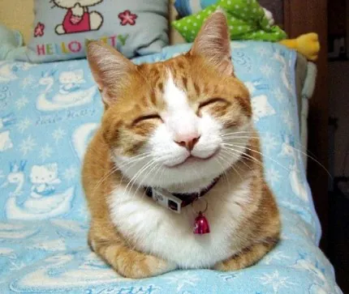
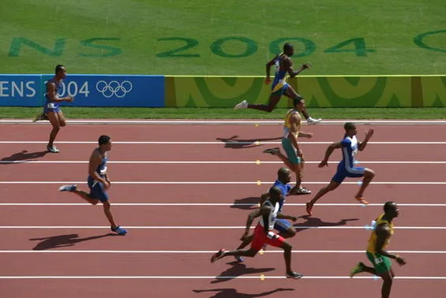
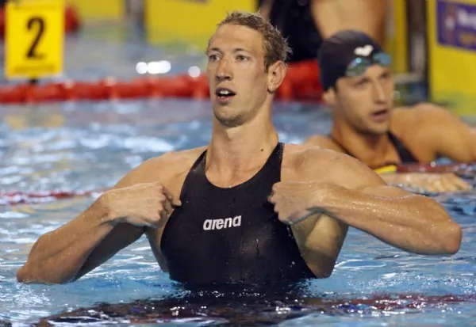
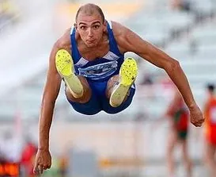

Enfin ! Enfin, les Jeux nouveaux sont arrivés ! Enfin la possibilité pour toutes les victimes de la crise de partir aux sports d'hiver par procuration. Et puis quel magnifique événement, vecteur de messages de fraternité, de courage, de partage... de naufrage. Mais derrière les mots et les banalités consensuelles, les Jeux sont surtout une véritable pépinière de procédés dictatoriaux. Les Jeux, il faut arrêter de croire que c'est un rassemblement populaire dans la bonne humeur. C'est en fait plus proche d'un abattoir à sportif à vocation lucrative.

La vérité, c'est tout ce qu'il nous reste quand on a perdu ses illusions. Si quelque chose est trop beau, soyez bien sur vos gardes. On vous vend, à travers des idées d'esprit olympique, une sorte de rêve, un bonheur insoutenable. On vous montre d'un doigt et avec insistance la beauté du geste pour pouvoir vous en caler un autre plus facilement. Regardez comme c'est beau, ce sportif au bout de lui-même, cet être entièrement dévoué à la victoire, et qui a négligé sa santé toutes ces années pour vous offrir le spectacle de son corps déformé par l'effort afin de gagner trois centièmes. Admirez la splendeur de ces émotions, pleines de larmes qui roulent et de souffles courts. Mais STOP ! Ne prenez pas de photos. Et avant de sortir, veuillez vous assurer d'être passé par notre nouvelle machine à laver la cervelle, que vous n'en gardiez aucun souvenir. Parce que oui, le "Comité" veille, et il vaudrait mieux pour vous ne pas discuter. Le remettre en cause, ce serait remettre en cause des valeurs ancrées dans l'esprit populaire depuis des dizaines d'années, à grand renfort de manipulation, et s'attirer dès lors les foudres de la société bien élevée.

Allez, juste pour le sport (ha ha), je vais faire le test. Si vous n'avez plus de nouvelles de moi d'ici la semaine prochaine, ne cherchez pas plus loin. Prêts ? Les Jeux Olympiques ! Et voilà, ça y est, j'ai violé devant vous, bande de complices, la première règle : on ne parle pas du Fight Club. Le "Comité", autorité suprême s'il en est, créé par le "Baron" en 1894 (ça y est vous la sentez, là, l'odeur de merde ?), a pour fonction première l'organisation des Jeux. Et pour activité principale de persécuter tout utilisateur non licencié du moindre élément ayant de près ou de loin un rapport avec la manifestation. Son créateur, le Baron de Coubertin (saloperie de français), partageait déjà à l'époque ces visées eugénistes et privatives en partageant l'humanité en deux races : celle au regard franc et aux muscles forts, et celle des maladifs. Parce que ne pas être musclé, c'est donc être malade, anormal, et devoir se résigner à ne jamais jouir de tous les privilèges de la vie civilisée afin de permettre le progrès colonial (sic). Mieux encore, le Baron mélange tout et considère l'Olympisme comme une religion, comparant les athlètes à des sculpteurs de corps, la sculpture étant pourtant un Art, et non une religion. Sauf que l’athlète moderne exalte sa patrie, sa race, son drapeau. Oh oui vas-y, donne m'en encore, du nationalisme, j'aime ça...

L'école des Jeux, c'est donc une école d'intolérance, de xénophobie, de sexisme et d'eugénisme. Et d'un racisme qu'on ne perçoit pas pour la simple raison qu'il ne concerne pas la différence de pigmentation de la peau, et que les gens ils croivent que ce qu'ils voivent, mais dont vous êtes tous complices en acceptant de partager l'euphorie des Jeux. D'ailleurs, je m'étonne de voir les femmes en profiter également, et même au delà, en ayant gagné leur place aux Jeux. Ce n'est pas du tout dans les commandements laissés par le Baron. Non, lui disait plutôt : "Une olympiade femelle serait impratique, inintéressante, inesthétique et incorrecte. Le véritable héros olympique est à mes yeux, l'adulte mâle individuel. Les J.O. doivent être réservés aux hommes, le rôle des femmes devrait être avant tout de couronner les vainqueurs." La femme, c'est donc globalement une sorte de prostituée qui se pâme pour le vainqueur et crache sur le perdant. Quoi que, d'un côté, c'est pas toujours faux. On appelle même ça des salopes, si je me souviens bien. Mais alors le "Baron", précurseur de l'expression "toutes des salopes" ? Possibeul !

Enfin, on pourra s'interroger sur la pertinence du choix sportif pour véhiculer des valeurs universelles lorsque le sport en lui même n'intéresse qu'une très faible part de la population, et empêche sa pratique à tout individu différemment constitué. La Musique et les autres Arts sont quant à eux bien plus ouverts. Seulement voilà, pour les apprécier il faut s'y intéresser. Mais s'intéresser, ça prend du temps. Et le monde manque de temps, tout va trop vite. Qui de nos jours est capable de comprendre toutes les subtilités que pourrait inclure un violoniste dans sa prestation ? Alors qu'en sport, c'est simple, il n'y a pas de questions à se poser. "Bé didont, il saute loin lui hein !". Si vous doutez encore, posez-vous la question : qui est le plus cultivé entre un commentateur sportif et un critique d'Art ? Pourquoi le sport n'est-il pas un Art ? Pourquoi nous rabat-on les oreilles avec cet usage intensif de notre corps ? La réponse est pourtant simple : se mettre au service de notre corps occupe d'abord notre esprit, pour finir par l'atrophier. Et devenir une bête. Les français sont des veaux ? En effet, comme une bonne partie de l'humanité. Il n'y a alors plus qu'à mener le troupeau.

Courrons tous ensemble à notre perte, mais n'oublions pas de battre des records en passant.
