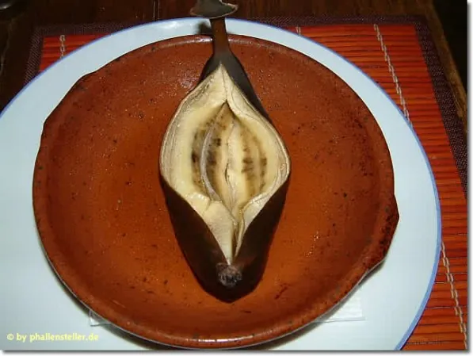

L'égalité des sexes, quelle niaiserie ! C'est pourtant du bon sens, les sexes ne sont pas égaux, et heureusement. Ne serait-ce que d'un point de vue du poids, moi je suis désolé, mais une livre de viande ne pèse pas autant que la bouche qui se destine à l'avaler. Déjà parce que pour la peser, la bouche, l'entreprise me semble hasardeuse. Peser un orifice, ça n'a pas de sens ! Alors, malgré tout le respect que j'ai, et même l'amitié - mais pas plus -, pour les homosexuels, vivre dans un monde où les sexes seraient égaux constituent pour moi un véritable enfer.

Je ne reviendrais pas sur toutes les aberrations d'un monde sans aucune différenciation sexuelle, dénué de toute séduction, pour m'engouffrer sur ce qui fera de vous un bon sexiste, bien gras, bien lourd, mais tellement pittoresque. C'est important, la tradition ! Pour commencer, un peu de sémantique. Sachez impérativement différencier les homophones. Avant tout, sachez qu'un homophone n'est pas un téléphone pédé, mais seulement un mot qui se prononce pareil qu'un autre. Je précise au cas où des lecteurs (déjà) machos lisent cet article, bien que ce postulat soit à la limite du paradoxe. Parmi les mots voisins qu'il ne faut pas confondre, on trouve en premier : les poils. Il vous faut désirer une femme sans poils, mais avec des poêles, sinon comment ferait-elle la cuisine. L'homme, au contraire, se doit d'être l'inverse. Attention cependant aux pièges du vocabulaire roturier. L'expression "à poils morue" n'a véritablement aucun sens. Tout d'abord parce qu'une morue n'a pas de poils, mais des écailles. Ensuite parce que lorsque le terme "morue" désigne une femme, celle-ci ne doit pas avoir de poils, comme nous venont de le voir. Il aurait donc mieux valu dire "à poêles morue", mais on aurait alors vu la femme s'en retourner en cuisine - d'où elle n'aurait jamais du s'éloigner - au lieu de se dévêtir intégralement, pour le plus grand plaisir de son singe poilu favori.

Un autre piège linguistique se cache également derrière les "moules". Cette fois-ci on voudra d'une femme qu'elle en dispose, autant que faire se peut, et ce n'est que d'un point de vue nasal qu'on lui recommandera de s'abstenir d'une imitation qui tomberait bien vite dans la répulsion. Car bien entendu, comment la femme pourrait-elle faire un gâteau à sa pilosité ambulante sans disposer de moules appropriés ? Par contre, il est important d'éviter tout ce qui est mal chez une femme. On voudra en effet d'une femme qu'elle soit pas mal, si possible, mais surtout, on voudra à tout prix éviter qu'elle soit mâle, parce qu'alors on risquerait de chopper une forte douleur anale - et on profitera de l'occasion pour la garder dans les annales. Tant qu'on y est, fuyez les tantes pour les mêmes raisons - à moins que ça vous tente. Au contraire, on demandera à la prétendante d'avoir une affection toute particulière pour les ballets, déjà parce qu'une danseuse est souple, ce qui est grandement profitable en période de rut, mais aussi parce que si ça peut lui permettre de faire un peu de ménage, ce sera toujours ça de gagné. Attention toutefois à ce qu'elle ne joue pas dans le lac des signes, auquel cas elle est probablement sourde et muette, ce qui risque de s'avérer handicapant lorsque, de votre fauteuil, vous l'enjoindrez verbalement à vous porter des bières, à vous ainsi qu'à vos amis.

Choisissez une femme touchée par la grâce, plutôt que par la graisse, ou, peut-être pire encore, par la Grèce - sauf si vous aviez bien aimé le passage sur les annales. Et si vous aimez les femmes bien en chaire, n'en prenez pas une bien en chair, au risque de devoir pousser son fauteuil roulant toute votre vie. Et que dire des bien trop chères, hors de budget et donc hors de propos. Vous pouvez donc éviter tout ce qui est reine, rênes - à moins d'être masochiste - et rennes - sauf zoophiles. Evitez les princesses aux souliers de vair, ainsi que celles à l'oeil de verre - c'est flippant -, celles tirant sur le vert - là c'est carrément flippant -, ou celles pleines de vers - rien que de vous en approcher ferait de vous un sacré malade. Gardez en tête que votre femme doit avoir un beau corps, mais surtout pas un beau cor, pour ne pas être pris en chasse et finir en sauce. Rien ne contre-indique, par contre, de choisir une bonne pâte, de même qu'une bonne patte, car il faut un peu des deux pour aller vous acheter de la bière et d'autres "trucs" à grignoter. Elle pourra posséder une belle voix pour jouer un beau chant, ainsi qu'une belle voie, pour jouer dans les champs. Enfin, c'est toujours mieux d'avoir du pot. Et puis c'est dans les vieux pots qu'on fait les meilleures soupes. Ce qui ne signifie pas qu'il faut choisir une vieille peau !

Vous l'aurez compris, la maîtrise de la sémantique quand on se destine à une carrière de machos est primordiale - alors qu'elle n'est pas du tout nécessaire pour travailler dans une carrière de nachos. Et quoi qu'il arrive, ne renoncez pas ! Devenir machos est peut-être difficile, mais sur le long terme ça paye. Il vous faudra néanmoins éviter de taper votre femme avec des coups, quand vous pourriez vous la... vous m'avez compris. Et puis la violence a un coût, mais pas l'embrasser dans le cou... Car oui, le macho a le droit de manifester un peu de tendresse, tant qu'en d'autre temps dresse. Mais je vois que je fatigue, alors je vous laisse las.
