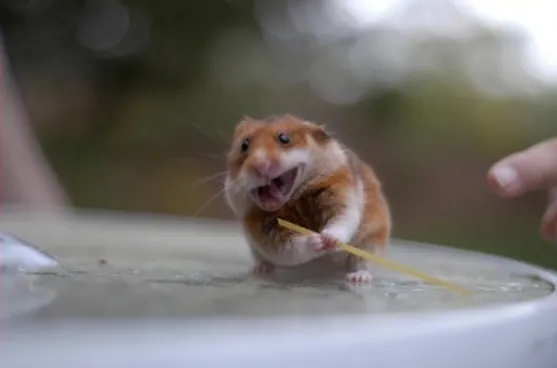
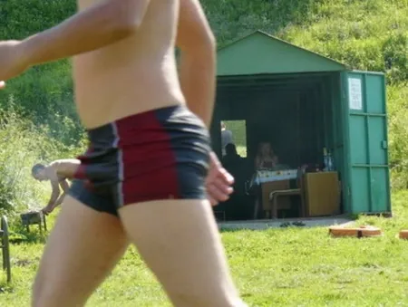
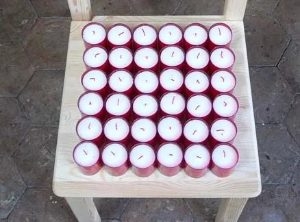

Le macho se doit d'avoir un humour très très lourd, de préférence plein de graisse. Un genre d'humour Mc Donald si vous préférez. Le mieux étant d'en revenir aussi souvent que possible au sexe, en teintant le tout de mépris à peine dissimulé derrière un rire à gorge déployée et un clin d'oeil appuyé à l'assistance masculine. Ainsi, nous allons aujourd'hui nous attacher au comportement à adopter face à quelques expressions courantes afin de devenir un macho hors pair - à défaut d'être hors du commun. Le crédo s'avère simplissime : prendre une expression dans son sens propre en y voyant systématiquement une allusion scabreuse. Exemples.

Yoyoter de la touffe. Un véritable caviar pour le pur mâle élevé à la testostérone. Déjà parce que le sens premier de l'expression, devenir fou, s'accommode facilement à toute présence féminine. Ensuite parce que la présence du mot "touffe" dans l'expression permet une digression bien opportune vers l'organe génital du sexe faible. Yoyoter de la touffe devient ainsi très vite synonyme d'aller-retour à vocation pseudo-procréative, ce qu'un bon gargarisme devrait rendre encore plus évocateur. On en profitera alors pour abuser de l'expression "Y'a pas l'feu au lac", non, c'est pas au lac qu'il y a le feu, si vous voyez c'que j'veux dire, ha ha ha, décidément, je suis vraiment un gros malin, et ça tombe bien, comme ça je fais des progrès en misogynie. De même, on pourra faire dériver "y'a anguille sous roche" si la demoiselle présente une surcharge pondérale manifeste et qu'on souhaite minimiser l'efficacité d'un autre mâle que soi-même sur le plaisir de la douce, le macho ne se contentant pas de railler le sexe opposé, mais également ses congénères à la fourniture équivalente afin d'établir une dominance pouvant lui attirer les faveur des jeunes femelles impressionnables et au QI préhistorique.

Venir à l'oreille de quelqu'un fait également partie des locutions jouissives, ce qui est définitivement le cas de le dire. En effet, là où n'importe qui pourrait y interpréter qu'une quelconque rumeur se serait perpétuée jusqu'à atterrir dans l'oreille d'un bon-entendant - et pourquoi pas ? -, le macho, lui, se doit d'y voir là une pratique sexuelle propre à d'obscurs films fétichistes dans lesquels le - ou les - papas chatouillent leurs asticots jusqu'à ce que la maman - ou la mémé - ait assez de crème auriculaire pour guérir de sa surdité, parce qu'elle aussi, c'est une grosse cochonne, et que c'est pas pour rien qu'elle est sourde, la vieille. Tant qu'on y est, on pourra souligner que le seul pleureur - jeu de mot remarquable pour le niveau intellectuel généralement reconnu à tout machiste, bien qu'inadapté en la circonstance, et désignant de manière fort surprenante le pénis -, que le seul pleureur, donc, verse des larmes de crocodile, ce qui est normal, étant donné la taille du serpent, puisqu'on en est à taper dans le reptile. Car oui, lorsqu'il s'agit d'écoeurer son monde, le mâle alpha sait fait preuve d'une créativité inhabituelle.

Voir trente-six chandelles est quand à elle une expression best-seller, pour peu qu'on arrive à la vendre, mais vu le niveau, avec un peu de flatterie on vous vendrait votre propre belle-mère que vous ne pouvez pourtant plus voir en peinture. Voir trente-six chandelles est un must-have - vous allez voir que vous allez finir par me l'acheter - parce qu'elle permet en même temps d'évoquer les sports de combat, que le macho aime par dessus tout, c'est d'ailleurs pas pour rien qu'il s'entraîne sur sa femme, comme un petit enfant recréant avec ses jouets les situations qu'il aura vues dans le manga télévisuel du matin à quatre images par secondes, mais également une pratique sexuelle multiple dans laquelle on imagine facilement la pauvre petite femme à peine nubile faire la rencontre de moult braquemarts turgescents afin de pouvoir se payer ses études de comptabilité qui la mèneront, au mieux, au poste d'assistante de direction, dont le travail est de soulager la-dite direction de ses trop fortes pressions en lui donnant un bon coup de main, ou, au pire, simple secrétaire dans un cabinet privé d'escrocs, dans lequel on lui demandera d'accorder aux clients toutes ses faveurs afin d'éviter un procès coûteux qui lui vaudrait probablement de perdre son boulot. Et, tant qu'on y sera, on pourra ajouter avec entrain l'expression "voir la Lune en plein jour", synonyme de la première dans son sens figuré, mais que l'approximation pornographique rapproche plus de la scène suivante de notre film, où les chandelles n'en finissent plus de saliver, et où l'intervention de l'astre nocturne et de son jumeaux siamois sera rendue nécessaire par le déroulement évident d'une trame scénaristique hautement éprouvante.

Une goutte d'eau dans la mer pourra également être rangée dans le carquois lexical du guerrier des temps modernes, en remplaçant simplement la mer par un de ses homophones. On trouvera alors l'équivalent cinématographique au rayon "femmes matures" du Sex Shop du coin de la rue, auquel on louera également l'expression "vieux loup de mère" ainsi que "le cheval boit la bride", bride étant alors un mot anglais désignant une femme promise, et cheval son partenaire de plaisir du rayon zoophilie et pratiques extrêmes. Malheureusement, on regrettera que "tutoyer le pontife" ne soit déjà une expression sexuellement explicite, mais on se félicitera d'avoir trop bu pour le remarquer, et on le rajoutera malgré tout à la note, celle-ci étant bien plus classe et vicieuse que le classique "tailler une pipe", dont l'image au sens propre n'évoque pas tant que ça la caresse buco-génitale tandis que notre découverte l'évêque déjà beaucoup plus, tu m'as compris.

Maintenant soyez patient, ce n'est pas encore terminé.
