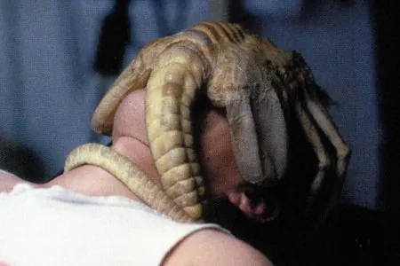

Même après avoir rigoureusement sélectionné sa femme en prenant garde aux homophones, le machiste n'est pas arrivé au bout de ses peines. Afin de pérenniser sa relation de dominance, il lui faudra prendre garde aux nombreuses expressions qui parsèment la langue et pourraient l'alerter sur tout état de fait inhabituel pour un homme de sa trempe. Certaines sont bassement ironiques et d'autres réellement trompeuses, et il est nécessaire de les maîtriser pour s'imposer comme un modèle de mâle alpha. En voici quelques unes qui sont primordiales à votre apprentissage.

"Avoir des couilles" est le meilleur exemple qui soit. Tout bon macho se doit d'avoir un jeu de couilles plus ou moins fonctionnel, selon son niveau d'addiction aux stéroïdes et autres substances hasardeuses. Pourtant, cette expression peut exceptionnellement s'appliquer à une femme, si celle-ci vous a fait une assez forte impression pour que vous la considériez comme l'égal de l'homme, ou presque. On remarquera néanmoins que pour compenser son évident déficit testiculaire, la femme aura besoin de fournir deux à trois fois plus d'efforts pour arriver à un tel résultat. C'est une des dures lois du sexisme. Par ailleurs, méfiez-vous : si on vous fait cette réflexion à propos de votre femme, c'est peut-être que vous lui laissez trop d'espace, trop de liberté pour s'affirmer, en la laissant par exemple ouvrir toute seule les pots de cornichons ou enfoncer un clou dans le mur. Il est alors temps de la reprendre en main, ce qui signifie, en plus de la peloter, de superviser ses actes afin que la moindre trace de courage vous revienne.

"Avoir des cornes". Vous pourriez vous laisser aller à penser qu'on vous fait la réflexion parce que votre puissance rappelle celle du taureau ou de tout autre animal de trait cornu et pesant pas loin de la tonne. Ah quel malheur est-ce pour moi de vous révéler qu'en réalité, pendant que vous vous fatiguiez à trainer la charrue à main nue alors qu'il y a des boeufs pour ça, votre femme se faisait tringler, telle une chemise qu'on enfilerait sur son cintre pour mieux la faire mouiller, ce qui n'a pourtant réellement aucun sens. En bref, vous êtes cocu, mais ne vous affolez surtout pas ! Non, tout bon macho est cocu en vérité. Mais si, regardez les films d'actions. La grosse baraque du début qui fout sa branlée au héros. Eh bien pendant tout le film sa femme lui fait des cornes en se faisant encorner par la moitié de la ville. Et pourtant, à la fin du film, elle choisit la voie de la raison et refuse de quitter son armoire à glace, parce que même s'il est fort et méchant, il a quand même un tout petit coeur quelque part qui bat pour elle, quand il n'a pas simplement le coeur de la battre elle, directement.

"Tirer les vers du nez". Peut-être que, maintenant que vous savez être cocu, vous souhaitez obtenir le nom de l'indélicate petite fiote à qui l'idée est venue de visiter le côté hétérosexuel et votre femme à la fois. Alors, vous désirez probablement lui arracher les mots de la bouche et lui tirer les vers du nez, comme on dit. Mais reposez votre boîte à outils, car vous risqueriez d'abîmer votre femme au delà du supportable, vous obligeant alors à repartir à la case départ : la recherche d'une compagne. Non, lorsqu'on tire les vers du nez de quelqu'un, ça signifie seulement qu'on arrive à lui extraire la vérité. Et l'extraction de vérité ne se fait pas à l'aide d'une pompe à vide ou de quelconque forceps. A la limite une bonne baffe suffit à honorer votre réputation de gros dur et obtenir un nom, sans occasionner de dégâts sur le long terme. N'y allez pas trop fort, elle doit être en état de passer à l'étape "réconciliation", si vous voyez ce que je veux dire...

"Avoir une brioche au four". Trop cool, c'est l'heure de goûter ! Eh non, c'était un piège ! Depuis quand le macho prend-il un goûter ? A la brioche en plus, non mais ça va pas. Une bière et des chips, voire du saucisson, ça c'est un bon encas de macho. La brioche au four, c'est seulement parce que vous vous êtes "trop" réconcilié avec votre femme, ou qu'elle vous a trop trompé avant. Et maintenant, elle a un polichinelle dans le tiroir, vous voyez. Un espèce de petit parasite qui lui bouffe le bide et qui, plus tard, lui déchirera les entrailles pour se frayer un chemin vers le grand air. Mais non elle n'a pas sucé un alien, et elle survivra, elle est faite pour ! Elle est en cloque, quoi, enceinte, grosse. Une bonne occasion de l'accabler de corvées pour tester ses limites et voir si vraiment, elle a des couilles.
