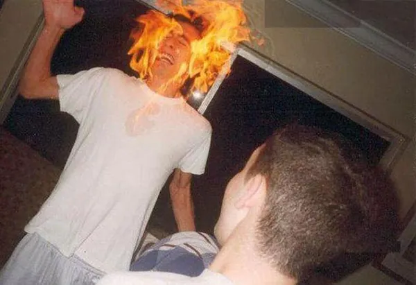
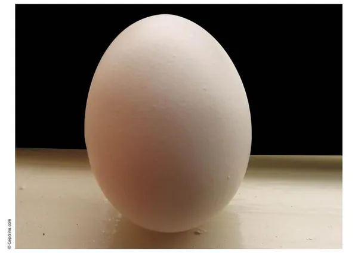
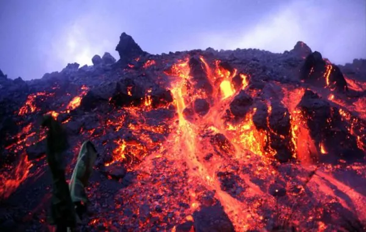

Si l'humanité n'était composé que de deux êtres humains, ceux-ci étant de modèle standard avec prétention et jalousie intégrées, nous aurions de fortes chances de les voir reproduire un schéma largement répandu dans notre société, le TPMG. Le Tout Pour Ma Gueule est un fonctionnement exclusif privilégiant son exécutant au détriment parfois létal de ses compatriotes. Nos deux crétins bipèdes ont dès lors une forte probabilité de connaître une fin précoce dans d'atroces souffrances. Et si à deux, c'est possible, je ne vois vraiment pas la difficulté de faire la même chose à sept milliards - bientôt, bientôt, les sept milliards.

Prenons une journée des plus banales. Le réveil sonne, le danger se lève, et vous aussi. Risque de niveau 1. Direction la salle de bain pour une bonne douche. L'eau coule, vous avez encore un peu de savon dans vos yeux à moitié assoupis, et vous avez oublié votre rasoir sur le lavabo. Vous passez votre bras par le côté du rideau pour ne pas mettre d'eau partout, et le cherchez en tâtonnant. La première menace est là, et vous guette. La coupure tétanique est là, et rêve de vous faire sombrer, immédiatement suivie par l'électrocution, induite par le sèche-cheveux laissé branché afin de le faire chauffer et que votre main mouillée vient caresser. J'espère que vos pieds sont bien assurés, ou ils pourraient bien glisser et vous faire choir lourdement la tête la première contre le lavabo. Et les produits dont vous vous tartinez la peau, sont-ils aussi sûrs que vous le pensez ? La douche terminée, la mort évitée, le petit-déjeuner vous attend fermement. Allez-vous plutôt mettre le feu aux rideaux en faisant griller une tartine, ou préférez-vous oublier de fermer le gaz pour vous faire une surprise explosive à votre retour ce soir ? Et que savez-vous de ce que vous ingurgitez ? Ce n'est pas bio, c'est donc traité par produits chimiques, qui accompagnent en vous le bol alimentaire comme celui de céréales. Et pourtant, vous avez fait le plus simple.

C'est plus que l'heure, vous devez vraiment y aller, sortir de chez vous. Le danger passe au niveau 2. L'ascenseur est en panne, et vous vous précipitez par les escaliers afin de ne pas être en retard. Des escaliers tout propres, encore humides de leur récent nettoyage. Tenez-vous bien à la rampe ! Vous sortez du bâtiment et respirez enfin l'air vicié de la civilisation. Et pour accélérer le processus de dégradation de vos poumons, vous vous allumez une cigarette en marchant jusqu'à l'arrêt de bus. Il fait beau aujourd'hui, et le soleil vous grille lentement la peau, menant irrémédiablement celle-ci vers le cancer. Tandis que vous approchez d'un passage piéton pour le franchir, le risque monte au niveau 3. Pire, la suite du parcours implique un passage sous un échafaudage. Vous n'imaginez même pas la quantité de choses qui pourraient vous tomber sur le coin de la tronche et poursuivez votre chemin. Le bus passe devant vous mais ne s'arrête pas : l'arrêt est à cinquante mètres. S'engage une course poursuite qui pourrait bien vous valoir un membre.
Le bus vous dépose à destination, et vous partez travailler. Durant tout le voyage, à n'importe quel moment, aurait pu se présenter un individu particulièrement colérique et ayant une dent contre toute la société, mais désirant vous le faire payer à vous, personnellement. Vous avez eu de la chance.

Vous êtes arrivé au bureau, c'est très bien, mais avez-vous vraiment confiance en votre direction. Si vous, chez vous, malgré vos précautions, vous avez du mal à éviter tout danger, comment votre patron, pour qui vous n'êtes qu'un pion, pourrait mieux vous garantir la sécurité. Pensez-y lorsque vous irez à la cantine. Et encore, aujourd'hui vous vous rendiez au boulot, mais vous auriez pu très bien aussi aller à la banque et risquer une prise d'otage, à l'hôpital et attraper une maladie nosocomiale, à l'aéroport et faire exploser votre niveau d'insécurité, ou simplement vous rendre dans une administration et mourir d'une attente interminable. J'aime bien ce terme, interminable. Les administrations ne s'adonnent-elles pas perpétuellement à un colossale trophée inter-minables ? Bref. Où que vous soyez, tout peut se retourner contre vous. Votre corps est tellement fragile que le moindre petit accroc qui ne lui est pas directement mortel peut impliquer une infection qui, elle, le sera. Vous avez en permanence besoin d'air, d'eau, de nourriture, de chaleur, mais pas trop, d'un environnement qui ne soit pas trop acide ou trop basique, ni trop mouvementé afin que vous restiez en un seul morceau, et avec des conditions de pression qui restent raisonnables mais sont néanmoins nécessaires. Une quantité affolante de produits chimiques, parfois tout à fait naturels, peuvent gripper votre mécanisme sans la moindre pitié, et c'est compter sans la multitude de prédateurs macro et microscopiques qui n'ont en tête qu'une seule chose : vous dévorer.

Vous pourriez donc vous dire qu'il vaut mieux rester chez soi. Mais même si vous vous sentez protégé de nombreuses menaces par votre présence au sein d'une communauté humaine dédiée à cet effet, c'est oublier que de bien plus graves dangers peuvent faire voler celle-ci en éclat. Des catastrophes, naturelles ou non, qui ne feront que peu de cas de votre petite personne lorsqu'elle vous avaleront tout cru. Comme la majorité des hommes, vous avez préféré vous installer près de l'eau. Les risques d'inondations sont statistiquement les moins dangereux mais les plus fréquents. Mais selon votre géolocalisation, vous pourriez tout aussi bien être confronté à un séisme, une éruption volcanique, un tsunami, un incendie, l'explosion d'une usine, un attentat, une guerre, la chute d'une météorite, et rester chez vous n'y changerait rien. Et je me dois également d'évoquer, par honnêteté intellectuelle, plein d'autres saloperies qui menacent la planète toute entière.

Alors s'il-vous-plait, arrêtez de me donner des conseils sur ce que je devrais manger, ou pas, sur ce que je devrais boire ou pas, et sur tout ce qui menace potentiellement ma santé ou mon intégrité physique. Si encore vous me disiez ça parce que vous tenez à moi. Mais non, pas du tout, ce que vous aimez, c'est donner des leçons et des ordres, alors allez vous carrer vos recommandations - et vos vaccins exotiques - bien profondément dans la porte de derrière. je vais vous dire une chose. Vivre, c'est mourir un peu. Nous courrons tous vers notre mort, qu'on le veuille ou non. Alors je compte bien en profiter pour me faire plaisir. Si c'est pour bouffer des trucs dégueulasses et payer plus cher pour avoir moins de confort, dans le but égoïste d'infliger au monde quelques années de plus d'une existence pathétique et inutile, c'est pas la peine. Surtout que du jour au lendemain, vous pourriez être renversé par une voiture ou bien peut-être même égorgé par un fou à qui vous auriez donné un conseil de trop.

Et je me sens particulièrement fou en ce moment.
