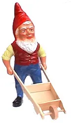
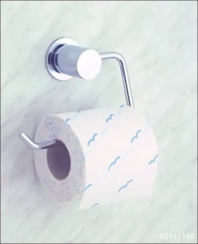
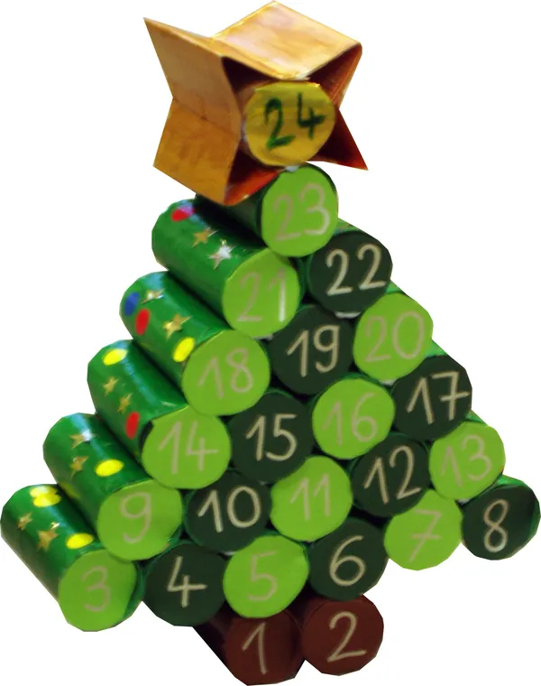

Alors que le sommet de Copenhague, qui culmine à 50m d'altitude et justifie dès lors la légitimité de la ville à organiser une rencontre écolo-capitaliste, puisqu'on n'est plus à un paradoxe près, se termine par un non-lieu, le bon peuple se prépare à honorer une tradition vieille d'une bonne centaine d'année et dont le principe se résume plus ou moins au gaspillage organisé, dissimulé par une large couche d'hypocrisie. Comédiens en tout genre, le moment est venu de battre des records.

En y réfléchissant, peut-être vous demandez-vous quel est le lien entre les crèches qui fleurissent à cette période de l'année, et la fête de Noël. D'autant plus que vous savez que le gentil Papa Noël est en réalité Saint Nicolas avec une fausse barbe. Mais à part ça, quel rapport pouvez-vous trouver avec la religion catholique ? Aucun ? Bingo. Il n'y en a aucun. L'église a récupéré à son crédit une fête populaire au point d'ancrer en nous qu'elle en était à l'origine, avec sa naissance du petit Jésus et ses mille et une autres foutaises. Et c'est tout simplement parce que cette fête nous vient des USA, et que là-bas, "In god we trust". La célébration de Noël s'est donc très rapidement retrouvée mêlée de messe de minuit et de nouveau-né se pelant ses nouvelles couilles, à poil dans une bergerie couverte de neige artificielle. D'ailleurs, et l'anecdote est intéressante, un vieux rite païen voulait que les jeunes se maquillent, à l'arrivée de l'hiver, et passent de porte en porte pour quémander des offrandes. Un moyen pour eux de se rassurer du fait que la nuit arrive plus vite et dure plus longtemps. Au Moyen-Âge, Âge Saint d'Entre Les Âges, l'église, cette coquine, reprit la coutume à sa sauce, et ce serait dès lors à Saint Nicolas de se coltiner toutes les maisons pour offrir des cadeaux aux enfants sages, comprenez ceux qui ont bien prié comme il faut. Et comble de l'ironie, ce bonhomme devrait payer sa tournée le jour de sa fête, le 6 décembre. Puis, de blague en blague, le "Santeclaus" (du néerlandais Sinter Klaas alias "MC Saint Nicolas Ho Ho Ho") devint un lutin qui se trimbale des cadeaux en traineau le 23 décembre, avant de redevenir un vieux barbu, mais entouré de lutins, et dont la tournée sera retardée par l'église au 25 décembre, afin d'avoir quand même un peu de monde à sa messe de minuit, pour l'anniversaire de la Naissance d'Horus, celui qui était né d'une vierge un 25 décembre, qui marchait sur l'eau, qui ressuscita e-Lazarus (sans doute était-il en avance sur son temps), qui eut 12 disciples, et qu'on appelait Iusa, qui est une version désuette de Joshua, donc Jésus, mais là je sais plus où je l'ai mis.

Et c'est alors que la malédiction était lancée sur toute l'humanité. Socialement, c'est devenu un véritable suicide que de ne pas faire de cadeau. Et le cercle vicieux a vite fait de vous absorber. Vous faites une fois un cadeau à un proche. L'année suivante, il va donc s'attendre à en avoir un autre. Sinon, il pensera que quelque chose ne va pas, et si vous avez le malheur de lui répondre que non, tout va bien, il pensera que vous êtes hypocrite et que vous ne voulez pas lui dire et que d'abord il boude. Mais pire encore seront ceux qui n'ont pas eu de cadeau la première fois. Ceux-ci, quand ils sauront qu'un de vos proches a eu son lot d'offrande, se demanderont pourquoi n'en ont-ils pas eu aussi. Et l'année suivante...

Alors voici ma recette pour éviter moult embarras. A Noël, offrez un brin d'écologie ! C'est très simple. Tout d'abord, ne prenez pas la voiture pour aller faire vos courses de Noël. De cette manière, vous économiserez du temps, de l'argent, et quelques kilos de CO2, ce gaz devenu méchant depuis qu'on a inventé l'écologie, probablement par contestation. Puis, n'achetez pas de cadeau. Ainsi, vous soulagerez un petit enfant chinois d'un jouet à fabriquer, et vous éviterez tous les déchets plastiques ainsi que le gaspillage d'énergie nécessaire à produire ceux-ci. Et pour finir, n'emballez pas votre cadeau, ou alors juste avec une feuille de papier-cul, parce que bon, on est pas des bêtes. Et voilà la solution. Pour Noël, offrez une feuille de PQ. Si vous êtes fan d'origami, vous pouvez même en faire de très belles choses. Distribuez-ça à tout le monde, avec un grand sourire, et voilà pour eux. Et puis rien ne vous empêche, le reste de l'année, de faire des cadeaux, à l'occasion. Et ceux-ci n'auront que plus de poids, puisqu'il n'y aura aucune raison particulière. Votre entourage se trouvera bien con de s'être forcé à vous offrir des babioles dégueulasses pour les fêtes quand vous leur aurez offert un bien plus beau cadeau, sans y avoir été obligé. Bien fait pour eux.

Mais par pitié, arrêtez avec vos putain de sapins. D'une, vous tuez un arbre ou vous affichez une grosse merde en plastique. De deux, c'est encombrant, et ça ne sert à rien. Et de trois, vous ne savez même pas ce que ça signifie ni comment il faut le préparer. Vous n'êtes juste qu'un espèce de gros mouton pataud qui fait comme les autres sans trop savoir pourquoi, et à la raie duquel j'urinerais volontier. Pour commencer, un sapin de Noël ne doit pas être érigé avant la veille de Noël. Et non, sinon il perd tout son sens. Ah oui, j'oubliais, vous ne savez même pas pourquoi vous faites ça, alors que ça perde son sens ne changera pas votre vie. Tenez, puisqu'on en parle, c'est justement de la vie qu'il s'agit. Le sapin, c'est une analogie à l'abre de vie, puisqu'il reste vert en plein milieu de l'hiver. On l'orne le 24 décembre d'hostie et de pommes rouges pour imiter la bible, et mélanger un peu tout ce qu'on trouvait et qui passait par là, à savoir rédemption et tentation. L'étoile en haut du sapin rappelle l'étoile qui guida dans la légende les rois mages vers la vie nouvelle, le petit nourisson, l'arbre de vie. Ben oui, je sais bien que c'est un Grand BazART, mais c'est ça de faire confiance à une église qui adapte au fur et à mesure tout ce qu'elle trouve dans le sens qui l'arrange le plus. Et si vous ne respectez pas cette religion, pourquoi donc copiez-vous les rites de ses adeptes ?

Alors si vous n'êtes pas plus chrétin que ça, contentez-vous de penser aux autres, voire de leur offrir UN cadeau, un seul, et n'en parlons plus. Et si vous trouvez un truc sympa à offrir à quelqu'un à qui vous tenez en plein mois de janvier, il n'est pas trop tard. Et début Novembre, il n'est pas trop tôt. Pourquoi attendre la période où le destinataire du cadeau en aura quinze autres autour de lui pour y ajouter le votre ? Vous ne voulez donc pas qu'il ait le temps d'en profiter ?

Réfléchissez à ce que vous faites, Bon Dieu !
