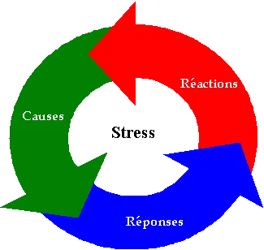
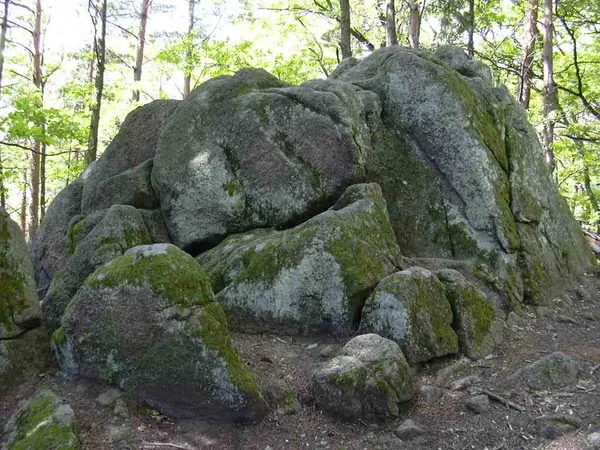
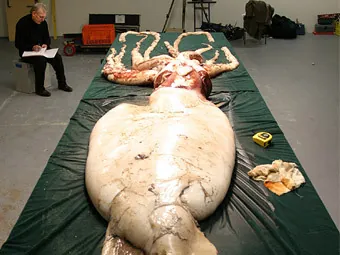
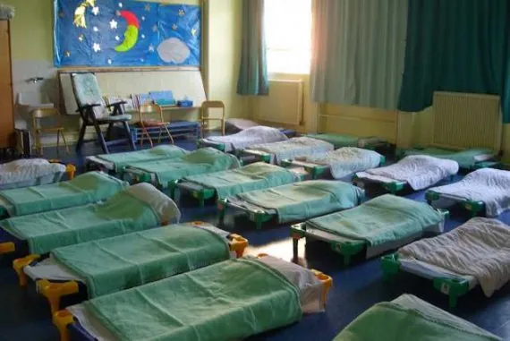

A une époque où contestation rime avec abstention, un nouveau parti politique semble ne pas se presser pour revendiquer sa légitimité et conquérir les urnes : [le Parti Mou](dead:http://grospatapouf.canalblog.com/). A l'origine, un constat simple : la société exige de nous d'être toujours plus rapide, fort, beau, efficace, disponible, généreux, et surtout de ne pas arriver en retard. L'idée, revendiquer le droit pour tous à ne rien faire. Parce que si avoir un toit et de quoi manger s'avère être physiquement indispensable, pouvoir rester au pieu pour profiter de tout ça s'impose comme une évidente nécessité.

"L'ennemi, c'est le dur !", nous confie un militant molliste entre deux bâillements. "Le monde appartient à ceux qui se couchent tôt", surenchérit immédiatement son voisin de sieste avant de se remettre à ronfler. Vous l'aurez comprit, le Parti Mou est plus que prêt à laisser le pouvoir venir à lui sans protester. Le leader du mouvement, anciennement premier secrétaire au Parti Nihiliste Flasque (à ne pas confondre avec l'excité Parti National Fasciste), se revendique pas moins de six milliards de sympathisants, "à la louche", dit-il, compter au delà de douze s'avérant diablement fatigant. "De toutes façons, on est tous plus ou moins des branleurs, il y en a juste qui s'ignorent". Les statistiques médicales semblent toutefois donner pleinement raison aux partisans du sommeil perpétuel, puisque la majorité des décès survenus avant l'âge naturel d'extinction des feux seraient causés par une activité quelconque, quand une très faible proportion de décès surviendrait en période d'inactivité totale.

Et quand la nature s'en mêle, on ne peut que s'interroger sur la nécessité d'aller toujours plus vite. En effet, la véritable hantise du Parti Mou serait la découverte du mouvement perpétuel, dont il a été maintes fois démontré l'improbabilité. Les lois physiques de notre monde, que même un président ne saurait transgresser, obligent à l'immobilité. Le mouvement demande de l'énergie. L'énergie sert le mouvement, l'activité. Mais l'épuisement des ressources énergétiques fossiles, ainsi que les phénomènes de frottements et d'inertie, tendent à nous prouver que la stagnation est ce qu'on attend de nous, notre raison de vivre. Le Parti Mou souhaite dès lors interdire le travail au delà des heures d'insomnie, et favoriser l'accès à la propriété d'un lit confortable, voire d'une chaise longue tout confort pour les plus défavorisés. C'est donc une position plus audacieuse encore que les Objecteurs de Croissance, bien que personne ici ne semble s'être intéressé à la question. "Je ne dirais pas qu'on va encore plus loin. Non, je dirais plutôt qu'on va encore moins loin, et c'est pour ça qu'on y arrivera plus tôt.", témoigne Archibald Acquin, défenseur apathique de la cause molle.

Déjà, l'organisation paresseuse envisage de confier le poste de président de la république à Bernard le calmar, dont la mollesse est incontestable. Avec lui, "terminé toutes ces histoires d'impôts, de démarches administratives, vous n'aurez plus qu'à vous laisser glisser dans le mou. On a beaucoup hésité avec Edouard le lézard, dont les siestes au soleil sont encourageante, mais la vitesse avec laquelle il se déplace nous a découragé de lui faire confiance. Il nous rappelait trop l'actuel président". Et quand on l'interroge sur la lutte contre la criminalité, c'est avec un sourire que nous répond le dirigeant des Compteurs de Moutons Unifiés - autre nom donné au parti, celui-ci se voyant attribuer un nouveau nom à chaque fois que les membres manifestent la flemme de se rappeler du précédent. "D'après nos statistiques, la plupart des crimes ont lieu dans la rue ou chez d'autres personnes. Alors, quel meilleure prévention contre la délinquance que de rester chez soi ?". Mais en plus d'éviter les morts accidentelles et les actes criminels, les casaniers se prémunissent également contre les cambriolages en affichant fièrement sur le portail de leur maison "Attention, chien ronflant", véritable mise en garde contre les intrus à l'esprit trop durement matérialiste.

Mais le Parti Mou souhaite aller encore plus loin en prônant le réchauffement global par l'intermédiaire de distributions de couettes, afin d'en finir avec les dérives du capitalismes. "Vous savez, dans le capitalisme, tout le monde en veut toujours plus, et se fatigue pour ça. Mais si on se mettait tous d'accord pour rester bien au chaud à la maison, quel intérêt les riches auraient à rester riche ? Vous savez, être meilleur que les autres n'a plus d'intérêt si vous êtes le seul à le savoir et que personne n'est là pour vous envier.", nous explique Paul Auchon, militant au Parti Vaguement Mécontent. "Dans notre société, on prétend que nous sommes tous égaux, mais tout le monde s'évertue à faire mieux que les autres pour se croire supérieur. Ce que nous voulons, nous, c'est une véritable égalité, universelle. Si plus personne ne fait rien, impossible de le faire mieux que les autres. Ici, au Parti d'Extrême Centre, on organise des concours d'onirisme intérieur pour montrer à quel point nous sommes extrêmement centrés - sur nous même, NDLR. Le perdant est celui qui se réveille le premier. Pour le moment, nous n'avons eu qu'un seul réveil, une taupe à Rolex qui n'a tenu qu'un quart d'heure dans son lit. Les autres dorment encore, ou au moins ils font bien semblant."

C'est donc dans un sentiment d'optimisme que nous repartons de l'antenne locale du Parti Avachi, convaincu qu'un nouveau monde est possible. Un monde dépouillé des péchés de ses capitaux, où le métier de banquier n'est plus qu'une mauvaise blague.
"L'argent, non, on en veut pas, c'est beaucoup trop dur pour bourrer les matelas."
