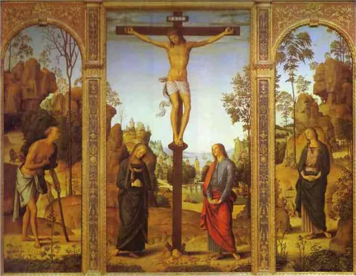
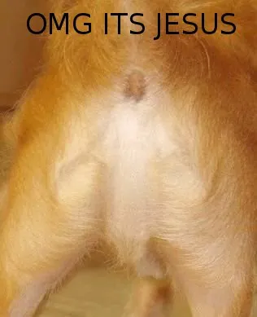
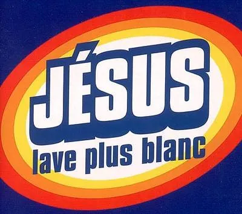
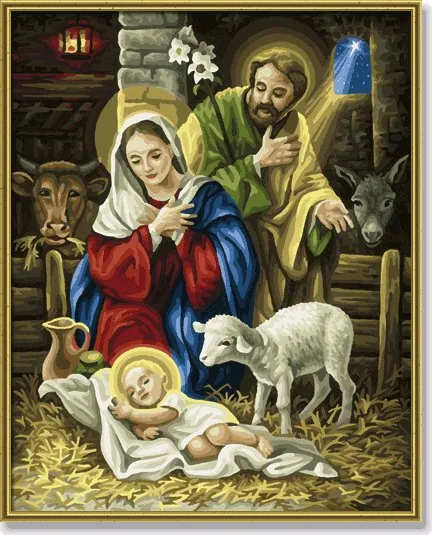

"*Dis papa, c'est quoi les nuages ?

- Mon fils, les nuages, ce sont toutes ces stars qui sont montées au ciel et qui s'éclatent en fumant des joints.*"

Alors que nos dirigeants sont partis picorer des petits fours à Copenhague en parlant du réchauffement climatique et de la cuisson des faisans, les médias nous diffusent en boucle des images de Marilyn Monroe fumant (peut-être) un joint. Pourquoi ?

- Parce qu'elle est morte. Lorsque vous mourrez, il se passe toujours quelque chose de magique, comme pendant la nuit précédant la date de péremption de vos yaourts. D'un seul coup, chacune de vos actions quotidiennes devient fascinante, à partir du moment où elles ont été filmées de votre vivant. La répétition de votre concert annulé pour cause de décès peut devenir le sujet d'un film qu'on diffusera au cinéma ! Alors que de votre vivant, vous aviez un mal fou à faire parler de vous, même en vous démarquant totalement du commun des mortels, d'un coup, avec votre mort, on commence à s'intéresser à la marque de votre crème contre les hémorroïdes, parce que, flash spécial, vous aviez des hémorroïdes, nous qui vous croyions si pur et si parfait. Marilyn Monroe fumait. Comme un bon quart de la population française. Sauf qu'elle est morte, et pas vous, et qu'on a des images d'elles, et pas de vous. Alors dépêchez-vous de terminer votre cancer, mais n'oubliez pas de filmer, sinon que voulez-vous qu'on montre à la télé.

- Parce que c'est la drogue !

Comment le sait-on ?

Eh bien, parce qu'on nous l'a dit. Ha ha, qu'il est con lui.

Qui nous l'a dit ?

Eh bien, le mec qui a filmé les images, et qui nous les a vendues.

Mais si la cigarette n'avait contenu que du tabac, la vidéo se serait-elle vendue ?

Ben non, tout le monde savait déjà que Marylin Monroe fumait du tabac.

Et d'où venait la "drogue" ?

C'est celui qui a filmé la vidéo qui l'avait apportée.

Bien bien bien. On a donc un type qui a été dans une soirée en compagnie de Marylin Monroe, qui l'a filmée en train de fumer, et qui ressort les images 45 ans après la mort de l'intéressée. Il affirme que c'est du cannabis, qu'il l'a apporté lui-même à la soirée, et, pas de chance, vu le temps qu'il a mis à ressortir les images, il est probablement le dernier homme sur terre à se souvenir de cette soirée (voir le dernier survivant y ayant participé). Et il n'y a rien qui vous choque ? Je ne sais pas, elle aurait pu prendre de la cocaïne, fumer une pipe à crack, se piquer à l'héroïne, mais non, il se trouve que tout ce qu'on voit, c'est une clope roulée dont on nous affirme qu'il s'agit d'un joint, ce qu'a déjà fumé plus d'un quart de la population. D'où le désintérêt général malgré le bégaiement médiatique. Le filon est moisi. Et qui c'est qui a bien gagné sa journée ?

- Parce qu'elle est belle et connue. Mais si, même si les images sont vieilles et de mauvaise qualité, la Marie en aura fait rêvé, des américains. Et je parle pas de la Marie-Jeanne, vous l'aurez compris. Alors si les américains en parlent, c'est que c'est intéressant, alors les français en parlent. Et puis il faut reconnaître à la Miss que son image rapporte encore plusieurs millions de dollars par an. C'est donc que ça fait vendre. Selon la loi du marché journalistique, ce qui se vend doit être montré. Et puisque c'est ce qui est montré qui se vend, on se retrouve fatalement à tourner en rond assez souvent. On a trop tendance à oublier la différence entre un journaliste, alors qu'en général, même s'il bêle plus fort, c'est un mouton comme les autres. Ca zoli, ça fait pognon, ça moi veut. Vous voyez, on pense qu'il faut être bon en langue, alors qu'en fait, on a pas besoin de beaucoup de vocabulaire dans ce métier.

- Parce qu'elle est d'une autre époque. Une époque où bon, c'est vrai, on fumait peut-être un petit joint de temps en temps, mais on se rendait pas compte, nous, on était jeunes et cons. Et puis c'était pas encore devenu dangereux, les joints, de toutes façons. Maintenant c'est différent, on le sait bien que la drogue c'est mal, voyez. Il vaut bien mieux trafiquer des images pédopornographiques, avec ça on est sûr de rencontrer des gens bien placés dans le monde de la "culture" et, qui sait, peut-être devenir un jour directeur de conservatoire ! Et puis de toutes façons, à l'époque, y'avait pas vraiment de règles. Surtout pour une enfant de la prohibition. C'est normal qu'après elle ait eu besoin de décompresser un peu, on peut lui pardonner. Et puis d'abord, elle a fumé du cannabis, et elle est morte. Alors on peut plus dire qu'on était pas au courant. Cannabis, hop, morte. Se droguer c'est mal, voyez.
