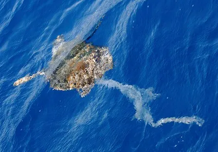

Vive le rien, vive le rien, vive le rien d'hiver ! Non, ce n'est pas une blague. Votre serviteur traverse en ce moment une passe nihiliste et reviendra vers vous dès son retour. Pourquoi faire ? C'est justement ça la question ! Mais pourquoi faire ? Vous-même, n'êtes-vous pas en quête d'un confort matériel hypothétique par l'humidification linguale systématique des gonades de votre supérieur ? Ne subissez-vous pas tous les affronts, toutes les déconvenues, dans l'espoir qu'un jour votre abnégation vous soit retournée sous une forme plus ou moins concrète vous offrant l'extrême jouissance de vous payer un resto de plus dans le mois, là où celui qui doit vous la procurer y passe la plupart de ses repas ? Peut-être vous prétendez-vous matérialiste, ou peut-être craignez-vous de l'être. Et de toutes façons, notre monde l'est, avec ou sans vous. J'ai donc choisi qu'il le soit sans moi. Je le serai de mon côté, voilà, na. Et, du haut de mon hédonisme certifié, je moque votre épicurisme involontaire. Sacrifier son présent à la recherche d'un futur à peine meilleur qui n'a que de faibles probabilités de se produire, n'est-ce pas là l'étrange absurdité dont vous êtes l'auteur malgré vous ? Je parie qu'en plus de ça, vous jouez au loto. Exactement la même démarche, quand on y réfléchit. Sacrifier son tient contre un million de tu l'auras... certainement pas. Alors non, ne comptez pas sur moi - et pourtant c'est dommage, je me débrouille plutôt pas mal en maths.

Alors me voilà nihiliste pour quelques temps. J'étais peinard, chez moi, devant un film malhabile et profondément décevant dénommé Pandorum, dans lequel l'humanité risque de s'éteindre, et paf, crise de nihilisme. On n'a rien pu faire pour me sauver. Et la fin du film n'a fait que me plonger un peu plus dans l'abîme du néant intellectuel. Alors, quand s'est présenté le moment de vous pondre ma petite entrave habituelle à votre joyeuse ignorance, je me suis dit que non. Et pour quoi faire d'abord ? Mince, la crise était plus grave que je pensais, au point d'atteindre mon utilitarisme avec l'aide d'un peu de mon pessimisme. Vous faire plaisir, pourquoi faire ? Vous remarquerez que la question s'avère particulièrement pratique en toute situation. J'ai même failli terminer mes jours dans une apnée conséquente à mes réflexions sur l'intérêt de la respiration. Ce n'est qu'après que l'instinct de survie soit entré dans le débat que je finis par céder. D'accord, la respiration revêt peut-être un certain sens dans quelques situations bien précises, comme la survie. Et celle-ci, on pourra lui apposer toutes les questions qu'on voudra, elle aura toujours le dernier mot, la garce. Impossible de lui résister. Je décidai donc d'être sage, et de lui être indifférent, tout en la laissant mener le jeu. Cette victoire acquise, enfin, à peu de choses près, il me fallait trouver conseil auprès d'un état d'esprit ne préconisant pas un arrêt significatif de mes fonctions vitales.

Et c'est alors que l'hédonisme se présenta. Une belle salope elle aussi. Et manichéenne par dessus le marché. Tout est 0 ou 1 avec elle, comme si elle sortait d'un ordinateur. Enfin, c'était toujours préférable au chaos absolu et permanent de ma partenaire précédente. Je me laissai donc séduire afin de voir où notre aventure nous mènerait. Peut-être arriverait-elle à vous sauver de mon absence, dépendants que vous êtes à ma magnificence - rappelez-vous, je suis en pleine crise existentielle, il ne faut pas me contrarier. J'engageai donc la conversation à ce propos, et profitai de l'échange que ma nouvelle prétendante me procurait. " En as-tu envie ? me dit-elle.
- Eh bien, comment dire... oui, répondis-je maladroitement.
- On ne dirait pas, objecta-t-elle immédiatement.
- C'est-à-dire que j'aimerais que ce soit fait, mais tu voudrais pas le faire à ma place ? l'implorai-je, les yeux brillants et les mains jointes.
- Ne dis pas de bêtises, me répondit-elle, je ne suis qu'un courant de pensée, je ne peux rien faire dans le monde réel.
- Ah mince, me ravisai-je.
- Il faudra que tu le fasses toi-même, me dit-elle alors.
- Mais j'ai la flemme ! intervins-je.
- Tu n'as donc pas envie, détermina-t-elle. Dans ce cas, ne le fais pas, me conseilla-t-elle.
- Tu as sans doute raison, convins-je. "
Je cessai là mes explorations grammaticales du passé simple et retournai vaquer à mes occupations ludiques informatiques.

Ce n'est que quelques jours plus tard, un jeudi dont j'étais absent, que je me rendis compte du vide que mon absence provoquait. Alliez-vous y survivre ? Qui étais-je pour vous infliger une semaine sans intervention de ma part ? Et si vous m'aviez pensé mort, ne vous laissant plus d'autre choix que le suicide, parce qu'à quoi bon vivre si ce n'est pas avec moi ? Ô comme je vous comprends. Moi-même, je ne serais rien sans moi. Alors, mon utilitarisme renaquit de ses cendres, tel un phénix et au moyen d'une formidable utilisation du passé simple dont je croyais pourtant avoir fait le tour au paragraphe précédent. Il vint à ma rencontre et engagea la conversation, comme si de rien était et qu'il était normal de discuter avec un oiseau de feu ou quoi que ce soit d'approchant. Il me tint à peu près ce langage : "Ô toi - et je sentis son respect dégouliner sur mon chef -, ne crois-tu pas que le bonheur de millions de gens - et je compris qu'il avait l'habitude d'en faire des caisses, ce qui expliquait par exemple le coup de la résurrection - est plus important que ta seule flemme - et je perçus alors la sagesse de ses paroles - ? - et je compris que faire une aparté juste avant un point d'interrogation n'avait aucun sens."
Et me revoilà.
