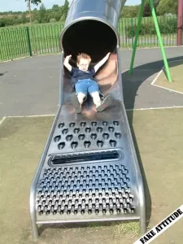

Récemment, une grande marque de Fast Food, connue internationalement pour ses terrains de jeux pour enfants, vient d'ouvrir un terrain de jeu pour adultes à Sidney, Australie. Alors qu'on pourrait se réjouir de voir une marque encourager les gens à ne pas trop se prendre au sérieux (même si elle se fait au passage un bon coup de pub), je fus une fois de plus surpris par l'étendue de la connerie humaine, pestant en masse contre un nouveau moyen de les rendre neuneus (WTF ???) !

A ce sujet, je ne sais pas si vous avez remarqué à propos des toboggans, mais un enfant qui fait du toboggan rappelle en nous la joie de l'insouciance de l'enfance. Un adulte sur un toboggan, par contre, ne nous évoque manifestement pas un grand enfant qui apprécie la vie et prend le temps de s'amuser, mais un attardé incapable de se débrouiller tout seul. Néanmoins, il vous suffit de mettre l'adulte à poils pour que, d'un seul coup, le toboggan disparaisse au profit de jugements moraux sur la frivolité du personnage. Il n'est plus un petit mouton débile, non, il est maintenant le mouton noir. Ce qui m'amuse fortement, c'est que tout le monde soit plus ou moins prêt à s'accorder sur le sujet. Pas besoin de vous rappeler la définition du mouton... Mais si vous voulez sauver cet homme sur un toboggan, c'est simple, mettez derrière lui une femme nue. Le tout évoquera un camp naturiste, et quand vous demanderez au Peucon moyen - celui-là même qui est d'accord pour dire que seuls les moutons sont toujours d'accord avec tout et n'importe quoi - ce qu'il pense de l'homme qui a l'air de bien s'amuser, il vous répondra qu'il ne lui trouve rien de particulier, et qu'à la limite ça ne l'a pas choqué, même si ce qu'il voudra dire est plutôt : "Ah bon, y'avait un homme dans la vidéo ?".

Pour être parfaitement drôle, que dis-je, irrémédiablement hilarant, amenez le Peucon moyen au pied du toboggan. Au milieu d'une foule qui s'amuse, regardez-le hésiter à bouder son plaisir avant de finalement s'en payer une bonne tranche. Sérieusement ! Profitez-en pour le filmer, ça pourra toujours servir, ne serait-ce que pour le faire chanter en le menaçant de révéler à sa femme ses relations extras-conjugales avec des pistes en plastique dont les rares frissons résident en de permanentes décharges d'électricité statique. Lorsqu'il aura payé la rançon, libérez les otages - vos images - auprès de sa femme. Devant sa déception, offrez de la réconforter. Bravo, vous avez tout gagné. Tant que vous y êtes, et puisque ces images n'ont plus d'importance, récupérez-les et montrez-les à un autre Peucon moyen, mais choisissez-en un avec une belle femme cette fois-ci, ou alors ouvrez une poissonnerie. Répétez toute l'opération jusqu'à ce que vous soyez soulagé de votre misanthropie, aggravée par le fait de voir à quel point vos compatriotes sont crétins de se faire avoir à chaque fois.

Un humain se disant citoyen voit dans l'initiative une véritable campagne d'infantilisation et de déresponsabilisation des masses. Selon lui, on consomme plus et de manière moins rigoureuse lorsqu'on ne réfléchit pas. Et il a probablement raison sur ce point. Ne reste qu'à prouver la relation de cause à effet. Le toboggan rend-il con ? Méditons sur la question. Qui utilise le plus ce genre d'appareil dans la société ? Les enfants. Sont-ils cons ? Totalement. Mince, aurait-on affaire à un grand sociologue ? Dans le doute, on évitera de croiser le regard d'un toboggan. Sérieusement ! J'en connais un qui devrait arrêter de faire du toboggan en cachette, ça lui monte à la tête. Alors quoi, quel est son problème finalement ? Serait-ce une crise épique de jalousie de ne pouvoir se rendre à Sidney pour profiter de la piste glissante géante ? Vite, messieurs du Fast Food, faisez construire d'autres jardins d'adultes partout dans le monde si vous ne voulez pas avoir une guerre sur les bras. Une guerre des boutons pour le contrôle du Toboggan du Destin !

Bref, cessons ces enfantillages. S'amuser, c'est mal vu, et pourtant. Ce n'est pas puéril, de s'amuser, c'est naturel. Ce qui est puéril, c'est de se moquer de ceux qui s'amusent parce qu'on aimerait bien en faire autant. Ce qui est puéril, c'est de jalouser les jouets du voisin, même si ce voisin est à l'autre bout du monde. Ce qui est puéril, c'est de s'acheter une grosse voiture à crédit pour en avoir une plus puissante que celle du voisin, tout ça pour se cantonner aux limites de vitesse, n'ayant pas les moyens de se payer un tour de piste. Ce qui est encore plus irresponsable, c'est d'exploser les limites de vitesse parce qu'on a pas les moyens de se payer un tour de piste à cause du crédit de sa voiture. C'est faire ses courses à Lidl pour avoir de quoi payer son écran plat de trois mètres sur deux. C'est porter une chemise hors de prix au dessus d'un jogging sale. C'est de tromper sa femme en cachette parce qu'on assume pas ses pulsions. Mais faire un petit tour de toboggan en passant, jouer aux cartes, aux petits chevaux ou même au jeu de l'oie, ça n'a rien de puéril, et vos enfants vous en seraient probablement reconnaissant.

Maintenant qu'on me laisse tranquille, j'ai un château de sable à terminer.
