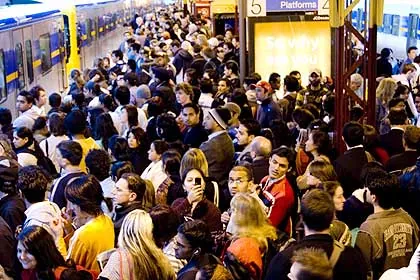

Une nouvelle année commence, mais rien ne change. Le chômage est toujours plus contagieux que la grippe A(H1N1'B72µ#x31), les hommes restent le cul vissé à leur canapé, et les femmes compensent leur manque affectif en se ruant par dizaine les unes contre les autres dans cet énorme pogo semi-organisé qu'on appelle ... Les Soldes !

C'est la tradition qui le veut, et on ne saurait y échapper. Des millions d'individus de sexe féminin destinés à s'échouer dans des magasins aux couleurs chatoyantes qui par le même coup leurrent toute raison qui leur pourrait rester. Tout ça pour l'événement, les soldes, de sexe masculin. A ne pas confondre avec la solde, synonyme de ce salaire que mon premier fera fondre comme neige au fourneau. Est-ce pour autant un complot du sexe flasque ? Que nenni, celui-ci se passerait volontier de ces heures d'attentes devant la cabine d'essayage à mettre son cerveau sur pause pour ne plus annoner que les mêmes rengaines super-enthousiastes. "Ah, wahou, ça te va mais.. trop bien quoi. Ah ? Non ? Ca te plait pas ? Oui tu as raison, ça te va pas tellement. Oui voilà, la couleur, probablement, c'est dommage." Mais alors qui organise cet attentat à la logique, ce rassemblement démoniaque, cette migration massive des femelles vers ce qui brille et qu'elle n'ont pas déjà, ou alors pas de la même couleur, ou alors si mais il est tout usé ? J'ai ma petite idée là dessus, mais étudions d'abord quelques uns des aspects de cette coutume qui défient l'entendement.

Pour commencer, et comme le disait très bien Jean Cocteau, "La mode, c'est ce qui se démode.". Ce à quoi j'ajouterai que ce qui se démode, c'est ce que vous payez deux fois trop cher pendant les soldes. Mais gardez le sourire, en temps normal vous l'auriez payé encore deux fois plus. Sauf qu'en temps normal, la femelle n'en aurait pas voulu. D'ailleurs, une fois l'achat effectué, celle-ci n'en aura plus aucun usage, puisqu'elle n'en voulait pas, au départ, mais vous comprenez, c'était tellement une bonne affaire. C'est d'ailleurs là le principe même des soldes. S'agglutiner dans les magasins bien au delà de ce que les normes de sécurité peuvent conseiller pour acquérir des articles dont personne n'a jamais voulu avant mais qui, par le pouvoir de leur étiquette "-30%", deviennent subitement magnétiques pour la gent féminine. Oh oui je vous vois venir, mais non, n'essayez pas de vous coller le même genre d'étiquette sur le front, vous aurez l'air ridicule et n'emballerez pas plus que d'habitude. Pourquoi ? Pas assez cher. Si vous en venez à de tels extrêmes, c'est que vous avez les crocs. Dès lors, vous vous sous-estimerez, et n'intéresserez plus personne. Avez déjà oublié le principe de cette période magique ? Acheter ce dont on n'a pas l'utilité à deux fois son prix. Non mais suivez un peu, je vais pas me répéter éternellement.

Le plus amusant quand on observe la femelle traquant sa proie dans un grand magasin, c'est de voir la tête qu'elle fera lorsqu'elle se rendra compte, après avoir trouvé l'article de ses rêves, que celui-ci n'est pas soldé. Vous la verrez d'abord froncer les sourcils, dans un réflexe d'incompréhension. Puis, ses yeux baissés, elle laissera la déception envahir son visage jusqu'à amener la larme à l'oeil de n'importe quel être humain normalement constitué. Même s'il ne s'agit que d'une énième paire de chaussure qu'elle ne portera peut-être jamais parce qu'au delà d'être très belle, celle-ci sont rudement inconfortable. Ce n'est pas grave, la femelle atteindra malgré tout l'apogée de la déception, le summum de la déconvenue, l'oscar du désappointement. Et, alors que son visage commence à présenter des signes d'une proche décomposition, elle se tournera vers l'homme qui l'accompagne, les yeux baissés, dans un rictus qu'elle sait irrésistible, attendant fébrilement la phrase magique : "C'est pas grave, on va le prendre quand même.". Après quoi, la femelle se désintéressera totalement de ce qui lui est d'ores et déjà acquis, son homme y compris, et se remettra en chasse d'un nouvelle bonne affaire du même ordre. Avec une probabilité énorme pour que sa prochaine découverte ne soit pas soldée non plus. Forcément, si ça plait, pourquoi le solder ? Au contraire même, pendant les soldes, tout article intéressant vera son prix démultiplié, étant donné l'affluence et la forte probabilité de le vendre.

Qui plus est, je tiens à attirer l'attention de ces messieurs sur un argument massue. Car désormais, il existe aussi les soldes flottantes, que les commerçants peuvent organiser quand ils veulent. Et, la plupart du temps, les femmes ont leurs habitudes. Elles n'iront donc que dans une sélection bien précise de magasins, parce que, selon elle, Jennifer, c'est pour les poufs, H&M, ça tombe jamais comme il faut, et Zara, c'est rien que des tantouses. Mais alors du coup, on est en droit de se demander : le bain de foule est-il réellement nécessaire ? Ah oui, ça réchauffe, c'est sûr, mais ne vaut-il pas mieux prendre un bon grog à la maison ? Un p'tit câlin avec ceci, j'vous garanti que ça réchauffe (sous réserve que ça soit fait correctement). Mais non, le cocooning, c'est trop classique, on le fait sans arrêt. Alors que le combat de catch géant que sont les soldes, ça, c'est original. Un rendez-vous à ne pas manquer. Ce serait dommage de se donner du mal toute l'année pour économiser si cet argent ne servait à rien. Mais vraiment à rien. Parce que même si vous parveniez à limiter les dégâts en terme d'achats, il faut compter avec le fait que se frayer un chemin parmi une foule en délire des heures durant, ça donne souvent soif. Et bien entendu, tous les cafés alentours sont pleins, même s'ils ont multipliés leurs prix par deux. Et vu le temps que vous aller y passer, il vous faudra également penser à vous restaurer. Et vous croyiez vous en sortir avec seulement deux robes, trois pantalons, cinq paires de chaussures et auinze petits T-shirts. Ha ha, naïf que vous êtes.

Maintenant, demandez à une femme pourquoi elle veux aller faire les soldes. Présentez vos arguments logiques, défendez-vous bordel, et vous verrez qu'elle ne trouvera aucune parade. Rien. Pourtant, vous irez quand même. Sinon, elle ira sans vous et ça sera pire encore. Les femmes sont programmées pour ça. C'est une certitude. Elles sont contrôlées à distance par l'armée des dauphins, qui se vengent ainsi de ne pas pouvoir se déplacer sur la terre ferme. Ils sont déjà les rois des océans. Mais si, même les requins en ont peur. Et sur la terre ferme, ils contrôlent aussi toutes sortes de poissons. Les thons... les morues... et je serai pas étonné qu'on trouve même quelques maquereaux dans le tas. Pas la peine de discuter, j'en suis sûr !

Une seule solution : trouvez-vous une femme agoraphobe.
