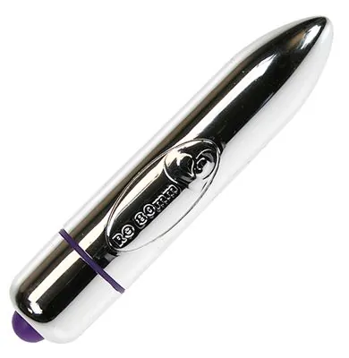

"Ferme ta gueule, conasse !"
Une chialeuse. Il n'avait jamais eu de chances avec les femmes de toutes façons.
"T'as intérêt à avoir terminé tes chocolats quand je reviendrai.
- Me laissez pas..."
Il avait coincé sa phrase dans la porte. Il l'avait déjà entendue une quinzaine de fois, et estimait que ça suffisait. Il se rendit à la cuisine et se prépara un café. Sur la table trônait encore la publicité pour les bouquets de fleurs de la Saint-Valentin. "Dites-lui avec des fleurs." Quelle blague. Il avait passé sa commande la veille, et bien qu'il vît par la fenêtre le soleil prendre congé, il n'avait toujours rien reçu. Pourquoi n'avait-il jamais droit à profiter des mêmes plaisirs que les autres gars de son boulot ? Eux avaient probablement déjà eut droit à une petite gâterie et se préparaient à aller dîner dans un grand restaurant. Tiens, le restaurant, encore un plaisir qui lui était refusé. Cette fois-ci comme les autres. Les circonstances lui laissaient si peu d'espoir qu'il n'avait même pas réservé de table quelque part. Pas avec cette chialeuse. Une autre fois peut-être. Tant pis, la soirée continuait, et le meilleur était à venir. Il se rendit dans la salle de bain, boucha la bonde et ouvrit le robinet. Lorsqu'il eut trouvé la température idéale, il laissa la baignoire se remplir en y ajoutant quelques huiles et sels de bain. Vanille et fraise étaient les deux parfums qui ressortaient le plus du pot-pourri. Deux parfums d'amour. Quel bonheur ! Et pourvu qu'elle apprécie. Il retournait dans la cuisine terminer son café lorsque l'interphone sonna.
"Oui ?
- Bonjour, Flora Speed, j'ai un paquet pour vous.
- J'arrive."

Cinq pour cent de sa paye mensuelle. Pour ce tas végétal multicolore.
"Tiens, c'est pour toi.
- Mais que...
- T'as terminé tes chocolats, c'est bien, je ne vais pas être obligé de me fâcher.
- S'il vous plait, laissez-moi...
- Ah non, tu recommences pas hein, j'en ai marre de tes jérémiades.
- Mais mon fiancé, il va bien finir...
- Ce soir, ton fiancé, c'est moi. Allez, viens, je t'ai fait couler un bain.
- Non, pitié, ne faites...
- Qu'est-ce que j'ai dit bordel !"
Il l'attrapa par le bras et l'emmena dans la salle de bain. La baignoire était presque pleine, et il coupa l'eau. Puis il la détacha et la pria de s'exécuter. Elle pleurait, mais il aimait bien ça. Il s'y était habitué. Les femmes, toutes pareilles. Il la regarda tomber quelques-uns de ses vêtements à la mode et la retint par le bras alors qu'elle s'apprêtait à entrer dans son bain.
"Tu n'oublies rien ?
- S'il vous plait, je voudrais...
- Non non non, quand on prend un bain, personne ne garde ses sous-vêtements. Allez !"
Il la regarda dégrafer son soutien-gorge et vit pour la première fois sa poitrine. Il sentait ses propres dessous devenir trop petits pour lui. Puis, elle retira sa culotte et découvrit une paire de lèvres dénuée de toute pilosité. Sans doutes avait-elle voulu préparer cette journée dédiée à l'amour en offrant à l'heureux élu ses plus beaux atours. Une larme, qui s'engageait entre les monts de Vénus, le fit sortir de sa torpeur.
"Allez, j'en ai marre de ton cinéma, assieds-toi sur le bord."
Timidement, la jeune femme déposa son postérieur sur le rebord de la baignoire. Ses jambes étaient jointes et son visage face au mur. Une posture tout sauf de bonne volonté.
"Non, dans la baignoire, les pieds."
Lorsqu'elle eut adopté la position dictée, il sut que la soirée touchait à sa fin. Il admira quelques instants le postérieur et y passa sa main. La canon de son arme directement posé sur son crâne, elle le laissa faire, non sans ajouter quelques pleurs. Alors, il la pencha en avant.
Il tira ses fesses en arrière, lui maintenant le torse contre les genoux.
Il tira son coup, faisant par moments cogner sa tête contre le mur.
Il tira dans la tête, répandant dans la baignoire un mélange de sang et de sperme.
Il se tira de chez elle, se réjouissant de cette merveilleuse Saint-Valentin.
