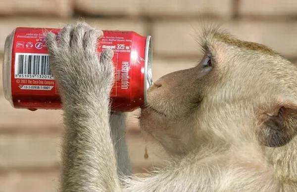
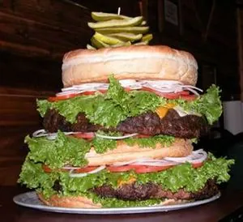
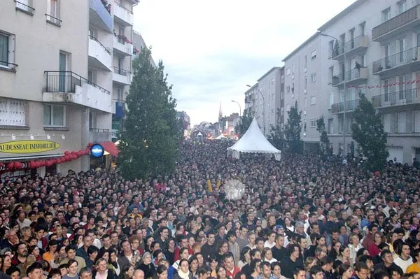
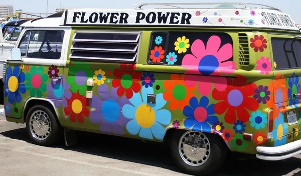
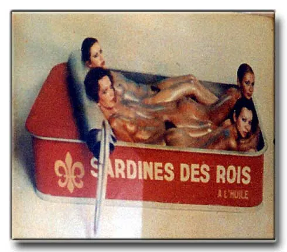

Nous vivons une époque formidable. L'humanité, dans sa course permanente à la survie, continue de se comporter comme si elle souhaitait son auto-destruction. Enfin, surtout celle des autres. A moins que leur vie ne me profite par la transaction d'un montant d'une valeur nominale. Et, alors qu'une partie de cette espèce pitoyable se creuse la tête pour rentabiliser la mode des tremblements de mère façon Parkinson, une petite proportion a trouver la solution pour faire de janvier un bon début d'année : taxer les gros. On a pas fini de se foutre de leur gueule.

De manière générale, il y a deux écoles dans cette affaire. Soit vous êtes obèse, et l'idée de payer plus cher votre billet d'avion vous révolte, parce que le pognon c'est l'oxygène et que vous n'êtes pas responsable de votre poids. Soit vous êtes plutôt mince, et vous trouvez normal de faire payer double une personne qui occupe le double de place et qui a un problème que vous n'avez pas. Comme bien souvent, le bon peuple prend le premier prétexte venu pour se fracasser le coin de la tronche à coup de mots blessants et d'arguments fallacieux. L'homo sapiens, autrement dit "l'homme sage", a décidément bien du chemin à parcourir avant de mériter son titre. En attendant son épiphanie, appelons-le donc homo rudis et n'en parlons plus. Et, puisqu'on est entre nous, penchons nous sur ce spécimen commun et tentons de nous mettre à sa place afin de comprendre son comportement. Tout d'abord, il faut savoir que l'homo rudis possède un cerveau remarquablement efficace, mais dont la seule tare est d'oublier sa propre existence. Ainsi laissera-t-il bien souvent son hôte démuni face aux péripéties que la vie lui imposera, préférant se faire discret et laisser aux réflexes le loisir de choisir l'attitude à adopter. Selon un schéma excessivement simpliste, ceux-ci analyseront donc la situation de la manière suivante : Est-ce positif ? Si oui, suis-je concerné ? Si oui, c'est bien. Sinon, c'est injuste. Est-ce négatif ? Si oui, suis-je concerné ? Si oui, c'est injuste. Sinon, c'est bien fait pour ceux qui le sont. Vous remarquerez dès lors que l'homo rudis possède une chance sur deux, quelque soit la nouveauté, de la considéré comme injuste. Dans le cas contraire, il ne lui reste plus qu'une chance sur quatre d'être vraiment satisfait, et la même proportion, à deux trois poils de couilles près, de libérer la haine que la vie lui inspire. Oui non, les histoires de couilles, c'est juste parce que je trouvais le sujet trop sérieux et que ça faisait longtemps que j'avais pas sorti un truc bien vulgaire.

Plaçons-nous maintenant du côté des doubles sièges. Pour certain, cette histoire d'enrobage dure depuis leur enfance. Ainsi, depuis toujours, ils sont exclus du coeur de la société, ne pouvant se faire d'amis que parmi les autres refoulés. Pattes-folles, lunettes-man, tache-de-vin, grandes-oreilles et yeux-en-vrac sont ses amis d'enfance. Adultes, ils ont retrouvé un statut social plus acceptable, ce monde considérant les exclus comme autant de chance de retrouver la bonne conscience que leur enfance de persécuteur leur a volé. Et voilà que ça recommence ! Pour autant, il semblerait qu'à aucun moment le "gros" ne se remette en question. Pourquoi suis-je gros ? pourrait être une réflexion libératoire.
Si c'est un choix, je l'assume et le revendique. Je suis différent et j'en suis fier. Auquel cas, j'accepte qu'on me traite différemment, quitte à devoir m'affranchir d'un timbre plus onéreux pour me poster vers quelconque destination exotique. Après tout, mes voyages se limitent généralement à lit-canapé-voiture-bureau-voiture-canapé-lit. Pour une fois que j'ai envie d'explorer le monde, est-il vraiment nécessaire de prendre l'avion ? Le vélo pourrait être une alternative intéressante, pouvant offrir moult surprises à moindres frais.
Par contre, si je n'ai pas choisi mon surpoids, peut-être pourrais-je essayer de comprendre quelle en est la cause. La génétique est une réponse certe très pratique, puisqu'elle permet l'exhaustion de toute responsabilité. Néanmoins, même avec mes gênes, ces salauds, m'est-il vraiment impossible de changer. Est-ce que je le veux vraiment ? Vais-je accepter de me passer de ces doubles-steaks que je mange deux fois par jour, mais avec deux haricots verts pour bien insister sur le fait que je fais des efforts ? Pourrais-je résister à la tentation du paquet de chips et du petit encas quand je m'ennuie toute la journée et que c'est la seule chose que je sais apprécier ? Finalement, si je n'ai pas envie de changer quoi que ce soit, peut-être devrais-je assumer ce que je suis, et prendre le train...

Mais il y a aussi les cul-serrés. Pour eux, qui n'ont aucun problème de poids, la vue d'un gros est synonyme de décadence. Le gros est méprisable parce qu'il se permet d'abuser des bonnes choses, et vient s'en plaindre après. C'est celui qui voudrait le beurre et l'argent du beurre. Avec un surplus de crème-fraîche sur un lit de saindoux. Moi qui suis raisonnable, je méprise donc ces gens qui sont différents. S'ils sont gros, ils l'ont bien cherché. S'ils sont malades ou handicapés, c'est pareil. Rien n'arrive par hasard. Pour moi, tout va bien, et je trouve ça normal, parce que je suis quelqu'un de bien. Lui, il est noir, déjà, alors que fait-il ici ? C'est pas un endroit pour les noirs ici, c'est pour les gens normaux. Moi je suis normal, depuis toujours. Parce que la normalité, c'est être mieux que les autres, et donc les mépriser. Paradoxalement, être normal, c'est ne pas savoir être humain. Mais si les gens normaux sont mieux que les autres, comment calculer la moyenne ? A moins que cette normalité supérieure ne soit compensée par un autre défaut, qui équilibre la balance. Peut-être suis-je un authentique connard, voilà la solution ! D'un côté, les gens malheureux, de l'autre côté, les connards. Et comme se comporter avec mépris n'est pas une grande preuve de bonheur ni de santé d'esprit, les deux groupes s'entremêlent. La voilà, la normalité : se croire différent en étant exactement pareil, à la seule différence que ça se voit moins de l'extérieur.

N'oublions pas pour autant les anges-gardiens. C'est le type de personne qui attend de voir de quel côté est le malheur pour défendre le malheureux et prendre part à l'affrontement en disant qu'il faut arrêter de se battre. C'est celui qui vous balance une saloperie pour vous faire comprendre que vous n'êtes pas mieux que les autres. Celui-là ne se croit pas supérieur aux autres, au moins. Il SAIT qu'il vaut mieux que les autres, puisque les autres se battent pour avoir raison et que lui n'est pas du tout là en bon voyeur amateur de catch, mais plutôt pour demander à tout le monde de se calmer, parce que sinon c'est vilain pas beau. Lui, c'est le pire, parce qu'il a bonne conscience. Le donneur de leçon, personne ne le supporte, parce que tout le monde sait qu'il a raison, mais il y a un détail qui fait qu'on a plus envie de lui faire passer l'envie d'ouvrir sa gueule plutôt que de le remercier. Ce détail, c'est sa propension à se croire indispensable. Personne n'est indispensable. Les gros, on s'en passerait. Les intolérants, d'autant plus. Mais alors les têtes à claques, et c'est probablement un des rares sujets qui mette tout le monde d'accord, faut les brûler. Trop indécis pour avoir une opinion bien tranchée, ces tantouses se permettent de demander aux autres de ne pas exposer les leurs ! Censeurs ! Hippie ! Bolchevique ! Nazis ! Le lecteur s'amusera lui-même à trouver d'autres interjections plus à son goût et à celui du jour pour qualifié ces pauvres d'esprit qui ne jurent que par le Peace and Love, écoutent de la musique ringarde sur leur chaîne hifi en plastique recyclé, et transpirent l'auto-satisfaction que ça vous rend une atmosphère étouffante en moins de deux.

Mais alors, de quel côté se placer ? Faut-il défendre les gros, qui sont des êtres humains comme les autres, voire même un peu plus ? Ou faut-il plutôt leur faire comprendre que c'est tout naturel de payer deux places quand on en occupe effectivement deux ? C'est délicat. Pour, contre, pour, contre ? Avec ceux qui sont contre ou contre ceux qui sont pour ? Et si la guéguerre nous avait tous fait perdre de vue la véritable source du conflit ? Voici l'énoncé du problème : "Les obèses qui prennent deux places dans un avion devront payer ces deux places pour voyager". Jusqu'ici, tout le monde s'est concentré sur le fait qu'un obèse est plus large qu'un siège d'avion. Mais dans l'équation 1o = 2p, il y a deux paramètres variables. Les obèses en sont un premier. Mais les places d'avions en sont un second. Tout le monde est tellement occupé à taper sur le voisin que personne ne s'est rendu compte que le problème ne vient peut-être pas de lui. Les obèses sont-ils un problème en train ? Non. Pourquoi ? Parce qu'il y a des banquettes, ou des sièges de largeur humaine. Sont-ils un problème en avion ? Oui. Pourquoi ? Parce que les sièges ne sont pas dans des dimensions humaines ! L'homo rudis pèse en moyenne 80 kilos. Donc, un siège destiné à le transporter doit être plus large qu'un humain de 80 kilos, afin de pouvoir contenir ceux qui sont en dessous de la moyenne, comme ceux qui sont au dessus. Un humain mesure en moyenne 1m70. Les portes font-elles 1m70 ? Non, elles prennent en compte les deux mètres que font les plus grands. Elles ne prennent pas en compte le record du monde de taille, mais se contente d'être suffisamment haute pour ne gêner qu'une minorité de la population. A l'inverse, les sièges d'avion gênent une majorité de la population. Moi-même, du haut de mes chétifs 70 kilos pour 1m80, je ne suis pas bien installé en avion. Ce n'est pas la normalité. Les obèses sont plus gros, oui, et alors ? Lorsqu'ils représentent plus d'un quart de la population dans certains pays, peut-on réellement les "oublier" ? Donc, c'est à celui qui prévoit des sièges minuscules pour rentabiliser au maximum ses vols d'assumer le fait qu'ils ne sont pas adaptés à toutes les morphologies, et à remédier au problème gratuitement s'ils ne veulent pas tomber sous le coup d'une discrimination manifeste. Après tout, fait-on payer plus cher les handicapés ? Non, parce que même s'ils peuvent faire ralentir le chargement de la marchandise, une fois dans la carlingue, on les plie dans un coin et on en parle plus. Mieux même, on peut sans doute en empiler deux l'un sur l'autre, permettant de faire l'économie d'un siège. Mais ferait-on payer moins cher une personne n'occupant que la moitié de son siège ? Bien sûr que non ! Alors, c'est que l'inverse n'est pas envisageable. Si vous l'envisagez, c'est que vous pensez comme un marché, et non comme un humain. Et alors, je vous plains.
